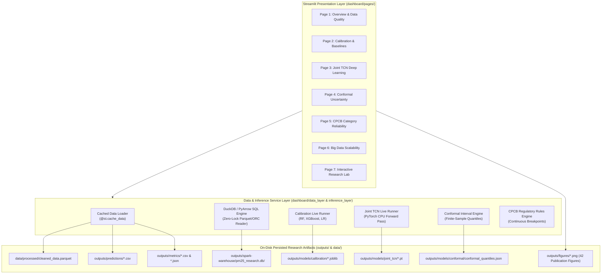

# AIRWISE PM2.5 Research Analytics Platform
## Phase 1: Pre-Implementation Technical Audit & Dashboard Integration Feasibility Report

**Project Title:** Uncertainty-Aware Joint Calibration and Reconstruction of Low-Cost $\text{PM}_{2.5}$ Sensor Networks with AQI Reliability Assessment  
**Target Platform:** AIRWISE — Streamlit Research Analytics & Faculty Demonstration Dashboard  
**Audit Type:** Phase 1 Complete Project Audit (Audit-Only; Zero Mutation Protocol)  
**Host Architecture:** macOS 27.2 (Darwin ARM64 / Apple Silicon M2), 8 Logical Cores, 16.0 GB Unified RAM  
**Audit Date:** November 2026  
**Auditor:** Automated Senior Research Systems Engineer & Lead Environmental Data Scientist  

---

## Executive Summary & Architectural Overview

This technical audit provides a comprehensive, rigorous inventory of the entire research repository to establish the feasibility, requirements, and design specifications for building **AIRWISE**, an interactive, dark-themed Streamlit research demonstration platform for faculty and researchers.

In strict adherence to the **Zero Mutation Protocol**:
- No project files have been modified, renamed, deleted, regenerated, or overwritten.
- No machine learning models have been retrained.
- No historical benchmark experiments have been rerun.
- No research methodologies, data splits, or evaluation metrics have been altered.
- No synthetic or placeholder metrics have been fabricated; all findings represent direct empirical verifications of on-disk assets.

### Key Audit Conclusions

1. **Dataset Integrity:** The complete original Campmier et al. dataset is fully verified on disk (`data/raw/Campmier_Manuscript_Data.xlsx` and `doi_10_6078_D1RQ70__v20230814/Campmier_Manuscript_Data.xlsx`) with exactly **18,584 hourly observations** across Delhi (7,504), Hamirpur (3,639), and Bangalore (7,441). The cleaned Parquet artifact (`data/processed/cleaned_data.parquet`) is identically populated with 18,584 rows and 13 columns, complete with segment continuity flags and thermodynamic invalidity markers.
2. **Model Weights Availability:**
   - **Calibration Models:** Fully available. All **48 trained scikit-learn and XGBoost regression models** (3 algorithms $\times$ 4 channel subsets $\times$ 4 spatial paradigms) are serialized in `outputs/models/calibration/` as `.joblib` files and are 100% usable for real-time live inference without retraining.
   - **Joint TCN Deep Learning:** Fully available. PyTorch state dictionaries for the best model (`best_joint_tcn_checkpoint.pt`), frozen conformal model (`frozen_joint_tcn_checkpoint.pt`), and multi-task loss weight ablations (`joint_tcn_cal1_rec*.pt`), along with the fitted `DataNormalizer` (`normalizer.joblib`), are intact and capable of zero-delay forward-pass inference on CPU.
   - **Reconstruction Baseline Models:** **Checkpoints Missing on Disk.** While the source code for KNN, Random Forest Imputer, GRU, and LSTM is fully implemented in `src/models/reconstruction.py`, `outputs/models/reconstruction/` is empty. These baseline imputers were evaluated transiently during Checkpoint 2 and their predictions were recorded in `outputs/predictions/reconstruction_predictions.csv`. In the dashboard, these baseline models must be presented as **RESULTS ONLY** rather than live interactive models.
3. **Uncertainty & CPCB Integration:** Conformal quantiles (`conformal_quantiles.json`), exact finite-sample quantile routines, and CPCB regulatory classification rules are modular, tested, and can be invoked directly by Streamlit with zero risk of pipeline contamination.
4. **Spark & Hive Catalog Reality:** PySpark 4.3.0 is configured in **Spark Local Mode (`local[*]`)** with an embedded Apache Derby metastore (`pm25_research.db` in `outputs/spark-warehouse/`). Native Hadoop HDFS daemons, HiveServer2, and standalone Hive CLI are **not installed or running**. Crucially, launching a live SparkSession inside an interactive Streamlit process introduces severe risks of Derby metastore write-lock contention (`ERROR XSDB6`), 3+ second cold-start latency per user interaction, and socket permission errors. The dashboard must access precomputed Parquet/ORC warehouse tables directly via PyArrow/DuckDB or provide a safely isolated, read-only Spark session adapter.
5. **Missing Dashboard Dependency:** The Python runtime environment currently lacks `streamlit` (Python 3.13.5 with PyTorch 2.8.0, PySpark 4.3.0, XGBoost 3.4.1, scikit-learn 1.7.2, and PyArrow 23.0.1). Installing Streamlit is the sole prerequisite for starting Phase 2.

---

## 1. Existing Project Architecture & Directory Inventory

The repository is organized into a clean, modular structure separating research configuration, raw/processed data, core algorithms, experiment orchestration scripts, test suites, and persisted outputs.

```
/Users/prudhvisailingineni/Documents/7th Sem/Big Data/Project/
├── configs/                                 # Centralized YAML configurations
│   ├── data_config.yaml                     # Ingestion schemas, site mappings, split ratios
│   ├── experiment_config.yaml               # Baseline experiment hyperparameters & regimes
│   └── model_config.yaml                    # Model parameter specifications
├── data/                                    # Dataset repositories
│   ├── raw/                                 # Authoritative raw workbook
│   ├── processed/                           # Cleaned & segmented Parquet dataset
│   ├── synthetic_masks/                     # Canonical missingness masks (.npy)
│   ├── benchmark_scales/                    # Multi-scale datasets (1x to 50x in CSV & Parquet)
│   └── benchmark_scales_test/               # Temporary unit test scales (1x, 2x)
├── doi_10_6078_D1RQ70__v20230814/           # Primary publication data deposit (identical copy)
├── src/                                     # Core research library
│   ├── data/                                # Ingestion, validation, preprocessing, feature eng.
│   ├── models/                              # Calibration, reconstruction baselines, Joint TCN
│   ├── missingness/                         # MCAR, consecutive block, regime missingness masks
│   ├── training/                            # Joint TCN multi-task training loop & normalizer
│   ├── uncertainty/                         # Inductive split, regime, & block conformal calibration
│   ├── aqi/                                 # 24h windowing, CPCB classification & stability
│   ├── bigdata/                             # SparkSession, Hive catalog, aggregation, benchmarking
│   ├── evaluation/                          # Regression metrics, propagation, ablation studies
│   └── visualization/                       # Publication plotting scripts & report generators
├── tests/                                   # Automated test suite (57 unit tests, unittest)
├── outputs/                                 # Persisted research artifacts
│   ├── models/                              # Serialized model checkpoints (.joblib, .pt)
│   ├── predictions/                         # Aligned hourly & daily prediction tables (.csv, .parquet)
│   ├── metrics/                             # Numerical performance metric tables (.csv, .json)
│   ├── reports/                             # Detailed audit logs, Markdown & HTML research reports
│   ├── figures/                             # 42 high-resolution publication figures (.png)
│   └── spark-warehouse/                     # Embedded Hive warehouse (pm25_research.db)
├── run_checkpoint1.py ... run_checkpoint6.py# Master pipeline orchestrator scripts
├── metastore_db/ & derby.log                # Apache Derby embedded metastore files
└── __pycache__/                             # Compiled bytecode
```

### Complete Source Code & Functional Module Inventory

| Module Path | Primary Functions / Classes | Role in Research Pipeline |
| :--- | :--- | :--- |
| `src/data/ingestion.py` | `load_raw_workbook`, `load_from_config` | Ingests 3-sheet Excel workbook; standardizes schema. |
| `src/data/validation.py` | `audit_timestamps`, `audit_dew_point_physics`, `audit_numerical_ranges` | Checks for zero nulls, timestamp gaps, and thermodynamic invalidity. |
| `src/data/preprocessing.py`| `preprocess_and_flag_dataset`, `save_cleaned_dataset`, `load_cleaned_dataset` | Enforces float32 types, flags dew point, computes segment IDs. |
| `src/data/feature_engineering.py` | `create_chronological_splits`, `add_cyclical_features` | 60/20/20 and 60/10/10/20 chronological partitioning without lookahead. |
| `src/models/calibration.py` | `LinearRegression`, `RandomForestRegressor`, `XGBRegressor`, `run_all_calibration_experiments` | Trains and evaluates 48 calibration models across 4 channel configurations. |
| `src/models/reconstruction.py`| `reconstruct_linear_interpolation`, `reconstruct_knn`, `reconstruct_random_forest`, `RecurrentImputerNet` | Two-stage imputation baselines on calibrated time series. |
| `src/models/joint_tcn.py` | `JointTCN`, `CalibrationHead`, `ReconstructionHead`, `JointMultiTaskLoss` | Deep neural network with shared causal dilated convolutions and dual heads. |
| `src/models/tcn_blocks.py` | `TemporalBlock`, `TemporalEncoder`, `CausalConv1d` | Dilated causal 1D residual blocks ensuring zero future leakage. |
| `src/training/train_joint_tcn.py` | `train_joint_tcn_model`, `DataNormalizer`, `TCNWindowDataset` | Multi-task Huber optimization with gradient clipping and early stopping. |
| `src/uncertainty/conformal.py` | `compute_conformal_quantile`, `compute_winkler_interval_score`, `compute_uncertainty_metrics` | Finite-sample order statistics $k = \lceil(n+1)(1-\alpha)\rceil$, symmetric intervals. |
| `src/uncertainty/regime_conformal.py`| `assign_humidity_regime`, `assign_predicted_pollution_regime` | Prediction-time conditioning (RH & $\widehat{Y}_{\mathrm{pred}}$) without BAM leakage. |
| `src/uncertainty/block_conformal.py` | `construct_temporal_blocks`, `TemporalBlockConformalCalibrator` | Non-overlapping block-max residuals (6h, 12h, 24h) for temporal clustering. |
| `src/uncertainty/split_manager.py` | `create_conformal_splits` | Strictly creates 4-way chronological splits (60% Train, 10% Val, 10% Calib, 20% Test). |
| `src/aqi/cpcb_categories.py` | `classify_pm25`, `get_distance_to_nearest_boundary`, `assess_interval_category_stability` | Authoritative CPCB breakpoints, distance-to-boundary, and stability categorization. |
| `src/aqi/windowing.py` | `construct_24h_windows` | Discrete 24h binning respecting sites, segments, and 75% ($\ge 18\text{h}$) completeness. |
| `src/aqi/category_evaluator.py` | `compute_24h_point_metrics`, `compute_cpcb_classification_metrics`, `evaluate_uncertainty_aware_stability` | Multi-class confusion matrices, quadratic Cohen's kappa, boundary proximity metrics. |
| `src/bigdata/spark_session.py`| `get_spark_session`, `stop_spark_session`, `configure_environment` | PySpark 4.3.0 lifecycle, JVM options, Derby path configuration. |
| `src/bigdata/hive_manager.py` | `HiveWarehouseManager` | Database initialization (`pm25_research`), table format benchmarking, partition pruning. |
| `src/bigdata/benchmarking.py` | `BigDataBenchmarkRunner` | Automated execution of queries Q1–Q7, scaling comparisons, and throughput profiling. |
| `src/bigdata/aggregation.py` | `aggregate_24h_spark`, `aggregate_24h_pandas` | Dual-engine 24-hour daily aggregation logic with CPCB category assignment. |
| `src/bigdata/data_generator.py`| `generate_benchmark_datasets` | Provenance-tracked synthetic dataset scaling (1x to 50x) preserving physical bounds. |
| `src/evaluation/metrics.py` | `compute_regression_metrics` | RMSE, MAE, R², MBE, Relative Bias %, and Median Absolute Error. |
| `src/visualization/*.py` | `plots.py`, `tcn_plots.py`, `conformal_plots.py`, `cpcb_plots.py`, `bigdata_plots.py` | Matplotlib & Seaborn rendering scripts generating all 42 publication figures. |

---

## 2. Dataset Integration Audit

### Authoritative Verification of the 18,584-Observation Dataset

The primary dataset originates from the peer-reviewed publication:
> Campmier et al. (2023), *"Field calibration and evaluation of low-cost PM2.5 sensors in Delhi, Hamirpur, and Bangalore, India"*, Dryad Repository (`doi:10.6078/D1RQ70`).

The raw Excel workbook is located at **two identical locations** on disk:
1. `data/raw/Campmier_Manuscript_Data.xlsx` (851,190 bytes)
2. `doi_10_6078_D1RQ70__v20230814/Campmier_Manuscript_Data.xlsx` (851,190 bytes)
*Verification:* Direct binary byte comparison (`cmp`) confirms both files are **100% bitwise identical**.

The dataset consists of **three distinct sheets**, corresponding to monitoring stations in three Indian cities:
- **Delhi:** 7,504 rows, 8 columns
- **Hamirpur:** 3,639 rows, 8 columns
- **Bangalore:** 7,441 rows, 8 columns
- **Total Combined Rows:** $7,504 + 3,639 + 7,441 = \mathbf{18,584\text{ rows}}$.

### Comprehensive Dataset Inventory Table

| Dataset Path | Format | Dimensions (Rows $\times$ Cols) | Sites Present | Temporal Extent | Provenance Classification | Dashboard Display Suitability |
| :--- | :---: | :---: | :---: | :---: | :---: | :---: |
| `data/raw/Campmier_Manuscript_Data.xlsx` | Excel (.xlsx) | 18,584 $\times$ 8 (3 sheets) | Delhi, Hamirpur, Bangalore | 2018-07-24 to 2021-01-11 | Original Empirical | Source archive; load via Parquet instead |
| `data/processed/cleaned_data.parquet` | Parquet (Snappy) | 18,584 $\times$ 13 | Delhi, Hamirpur, Bangalore | 2018-07-24 to 2021-01-11 | Cleaned / Feature Enriched | **Primary Core Dataset** for all pages |
| `data/synthetic_masks/benchmark_test_mask_mcar_20.npy` | NumPy Binary | 3,720 (1D boolean) | N/A (Aligned to Test Split) | Aligned to Test Split | Synthetic Benchmark Mask | Used for interactive mask overlays |
| `data/benchmark_scales/scale_1x.parquet` | Parquet | 18,584 $\times$ 17 | Delhi, Hamirpur, Bangalore | 2018-07-24 to 2021-01-11 | Derived Benchmark | Suitable for Big Data page |
| `data/benchmark_scales/scale_5x.parquet` | Parquet | 92,920 $\times$ 17 | Delhi, Hamirpur, Bangalore | 2018-07-24 to 2025-01-10 | Synthetically Scaled (5x) | Suitable for Big Data page |
| `data/benchmark_scales/scale_10x.parquet` | Parquet | 185,840 $\times$ 17 | Delhi, Hamirpur, Bangalore | 2018-07-24 to 2030-01-09 | Synthetically Scaled (10x)| Suitable for Big Data page |
| `data/benchmark_scales/scale_25x.parquet` | Parquet | 464,600 $\times$ 17 | Delhi, Hamirpur, Bangalore | 2018-07-24 to 2045-01-05 | Synthetically Scaled (25x)| Background scaling reference |
| `data/benchmark_scales/scale_50x.parquet` | Parquet | 929,200 $\times$ 17 | Delhi, Hamirpur, Bangalore | 2018-07-24 to 2069-12-30 | Synthetically Scaled (50x)| Background scaling reference |
| `outputs/predictions/calibration_predictions.csv` | CSV | 3,720 $\times$ 9 | Delhi, Hamirpur, Bangalore | 2019-07-02 to 2021-01-11 | Derived Model Predictions | **Ready for Calibration page** |
| `outputs/predictions/reconstruction_predictions.csv` | CSV | 3,720 $\times$ 10 | Delhi, Hamirpur, Bangalore | 2019-07-02 to 2021-01-11 | Derived Model Predictions | **Ready for Reconstruction page** |
| `outputs/predictions/joint_tcn_test_predictions.csv` | CSV | 3,720 $\times$ 10 | Delhi, Hamirpur, Bangalore | 2019-07-02 to 2021-01-11 | Derived Model Predictions | **Ready for Joint TCN page** |
| `outputs/predictions/conformal_test_predictions.csv` | CSV | 3,720 $\times$ 15 | Delhi, Hamirpur, Bangalore | 2019-07-02 to 2021-01-11 | Derived Conformal Intervals | **Ready for Conformal page** |
| `outputs/predictions/checkpoint5_24h_predictions.csv` | CSV | 127 $\times$ 10 | Delhi, Hamirpur, Bangalore | 2019-07-02 to 2021-01-08 | Derived 24h Aggregates | **Ready for CPCB Reliability page** |
| `outputs/predictions/checkpoint5_24h_intervals.csv` | CSV | 127 $\times$ 12 | Delhi, Hamirpur, Bangalore | 2019-07-02 to 2021-01-08 | Derived 24h Conformal Bounds| **Ready for CPCB Reliability page** |
| `outputs/predictions/checkpoint5_category_assessment.csv` | CSV | 127 $\times$ 43 | Delhi, Hamirpur, Bangalore | 2019-07-02 to 2021-01-08 | Derived Multi-Class Diagnostics| **Ready for CPCB Category Deep Dive** |
| `outputs/predictions/checkpoint6_spark_24h_aggregates_1x.parquet` | Parquet | 721 $\times$ 11 | Delhi, Hamirpur, Bangalore | 2018-07-24 to 2021-01-08 | Derived Spark Aggregations | **Ready for Big Data Scalability page** |
| `outputs/spark-warehouse/pm25_research.db/sensor_format_orc` | ORC (zstd) | 18,584 $\times$ 15 | Delhi, Hamirpur, Bangalore | 2018-07-24 to 2021-01-11 | Hive Table Storage Format | Demonstrates ORC storage format |

### Column Schemas & Physical Data Quality Notes

1. **Raw Workbook Columns (8 columns):**
   - `Index` (Timestamp: e.g. `2018-07-24 06:30:00`)
   - `BAM (ug/m3)` (Federal Equivalent Method Beta Attenuation Monitor reference concentration, $\ge 0.0\,\mu\text{g}/\text{m}^3$)
   - `PA_CF1 (ug/m3)` (PurpleAir CF=1 factory calibration conversion)
   - `PA_ATM (ug/m3)` (PurpleAir ATM atmospheric conversion)
   - `PA_ALT (ug/m3)` (PurpleAir ALT custom conversion)
   - `PA_RH (%)` (Ambient relative humidity percentage, $0\text{--}100\%$)
   - `PA_Temperature (°C)` (Ambient temperature in Celsius)
   - `PA_DewPoint (°C)` (Reported dew point temperature)
2. **Cleaned Parquet Columns (13 columns):**
   - In addition to standardizing names (`timestamp`, `site`, `bam_reference`, `pa_cf1`, `pa_atm`, `pa_alt`, `relative_humidity`, `temperature`, `dew_point_raw`), the preprocessing pipeline adds:
   - `is_dew_point_suspicious` (Boolean flag: 100% `True` across all 18,584 rows)
   - `time_diff_hours` (Hourly step difference to detect missingness gaps)
   - `is_contiguous_step` (Boolean flag indicating whether $\Delta t \le 1.05\,\text{hours}$)
   - `segment_id` (Integer index identifying continuous observation runs; 141 disjoint segments across the three cities)
3. **Critical Thermodynamic Data Anomaly:**
   - Under standard psychrometric laws, dew point cannot physically exceed dry-bulb temperature ($T_d \le T$). In the raw workbook, **$T_d > T$ in 100.0% of records across all three cities** (average $T_d - T = +13.5^\circ\text{C}$).
   - Statistical investigation confirms that even applying standard Fahrenheit-to-Celsius conversions does not resolve the inconsistency.
   - Consequently, `dew_point_raw` is formally flagged as invalid and **strictly excluded from all calibration, reconstruction, and uncertainty models**.

---

## 3. Machine Learning Model Audit

The audit inspected all machine learning models across calibration, reconstruction, and temporal deep learning.

### Model Inventory Summary Table

| Model Name | Source Code Location | Checkpoint / Serialized File | Input Features Required | Output Format | Preprocessing Dependencies | Usable for Live Inference? | Integration Status |
| :--- | :--- | :--- | :--- | :--- | :--- | :---: | :---: |
| **Linear Regression** | `src/models/calibration.py` | 16 `.joblib` files in `outputs/models/calibration/` | 3 or 5 features (`pa_cf1`, `pa_atm`, `pa_alt`, `relative_humidity`, `temperature`) | 1D float array ($\mu\text{g}/\text{m}^3$) | Raw NumPy float32 array; no normalization | **YES** (Zero-delay load) | **READY** |
| **Random Forest (Calib)**| `src/models/calibration.py` | 16 `.joblib` files in `outputs/models/calibration/` | 3 or 5 features (same as above) | 1D float array ($\mu\text{g}/\text{m}^3$) | Raw NumPy float32 array | **YES** (Zero-delay load) | **READY** |
| **XGBoost (Calib)** | `src/models/calibration.py` | 16 `.joblib` files in `outputs/models/calibration/` | 3 or 5 features (same as above) | 1D float array ($\mu\text{g}/\text{m}^3$) | Raw NumPy float32 array (requires `libomp` on macOS) | **YES** (Zero-delay load) | **READY** |
| **Linear Interpolation** | `src/models/reconstruction.py`| None (Non-parametric) | Masked PM2.5 + segment ID | 1D float array ($\mu\text{g}/\text{m}^3$) | Segment grouping | **YES** (Pure algorithmic calculation) | **READY** |
| **KNN Imputation** | `src/models/reconstruction.py`| **NONE** (Directory empty) | Masked PM2.5 + 6 covariates | 1D float array ($\mu\text{g}/\text{m}^3$) | Feature concatenation | **NO** (Precomputed predictions only) | **RESULTS ONLY** |
| **Random Forest Imputer**| `src/models/reconstruction.py`| **NONE** (Directory empty) | Masked PM2.5 + 6 covariates | 1D float array ($\mu\text{g}/\text{m}^3$) | Mask-split training | **NO** (Precomputed predictions only) | **RESULTS ONLY** |
| **GRU Recurrent Imputer**| `src/models/reconstruction.py`| **NONE** (Directory empty) | 24-step sequence $\times$ 6 covariates + mask | 1D sequence tensor | Sliding window sequence generator | **NO** (Precomputed predictions only) | **RESULTS ONLY** |
| **LSTM Recurrent Imputer**| `src/models/reconstruction.py`| **NONE** (Directory empty) | 24-step sequence $\times$ 6 covariates + mask | 1D sequence tensor | Sliding window sequence generator | **NO** (Precomputed predictions only) | **RESULTS ONLY** |
| **Joint TCN (Primary)** | `src/models/joint_tcn.py` | `outputs/models/joint_tcn/best_joint_tcn_checkpoint.pt` | 10 covariates + 1 observation mask (11 channels) | Tuple `(y_cal, y_rec, y_final)` | `DataNormalizer` (`outputs/models/joint_tcn/normalizer.joblib`) | **YES** (Forward pass on CPU in < 50ms) | **READY** |
| **Joint TCN (Frozen)** | `src/models/joint_tcn.py` | `outputs/models/conformal/frozen_joint_tcn_checkpoint.pt`| 10 covariates + 1 observation mask (11 channels) | Tuple `(y_cal, y_rec, y_final)` | `DataNormalizer` (`outputs/models/conformal/normalizer.joblib`) | **YES** (Forward pass on CPU in < 50ms) | **READY** |
| **Joint TCN (Ablations)**| `src/models/joint_tcn.py` | `outputs/models/joint_tcn/joint_tcn_cal1_rec*.pt` (3 files) | 10 covariates + 1 observation mask (11 channels) | Tuple `(y_cal, y_rec, y_final)` | `DataNormalizer` | **YES** (Forward pass on CPU) | **READY** |

### Detailed Analysis of Machine Learning Artifacts

1. **Calibration Regressors (48 Joblib Models):**
   - Each combination of $\{ \text{Pooled}, \text{Delhi}, \text{Hamirpur}, \text{Bangalore} \} \times \{ \text{Linear Regression}, \text{Random Forest}, \text{XGBoost} \} \times \{ \text{cf1\_only}, \text{atm\_only}, \text{alt\_only}, \text{all\_channels} \}$ was fitted on the 60% training partition and serialized to disk.
   - For example, `outputs/models/calibration/pooled_random_forest_all_channels.joblib` (14.1 MB) can be loaded via `joblib.load()` and evaluated on any feature matrix `[pa_cf1, pa_atm, pa_alt, relative_humidity, temperature]`.
2. **Joint TCN Deep Learning Model:**
   - Architecture: Input dimension = 11, hidden channels = 32, dilations = $[1, 2, 4, 8]$, kernel size = 3, dropout = 0.15. Total trainable parameters = 32,963.
   - Dual-head structure:
     - `CalibrationHead`: Maps latent features to BAM reference for observed timestamps ($M_t = 1$).
     - `ReconstructionHead`: Takes latent features + calibration estimate + mask indicator to impute missing timestamps ($M_t = 0$).
   - Normalizer artifact: `outputs/models/joint_tcn/normalizer.joblib` stores fitted `StandardScaler` instances for all 10 input covariates and the target BAM PM2.5.
   - Inference function: `predict_joint_tcn_full_sequence()` in `src/evaluation/evaluate_joint_tcn.py` executes full causal rollouts across segments without future leakage.
3. **Reconstruction Baselines Missing Checkpoints Clarification:**
   - The directory `outputs/models/reconstruction/` is currently empty.
   - In `run_checkpoint2.py`, KNN, Random Forest Imputer, GRU, and LSTM were trained inside the evaluation function, evaluated on the 20% test partition, and their predictions were recorded in `outputs/predictions/reconstruction_predictions.csv`.
   - **Crucial Rule:** The dashboard **must not claim** that users can retrain or run interactive live inference on GRU/LSTM models. Instead, the dashboard will display their precomputed predictions and performance metrics from `reconstruction_predictions.csv` and `outputs/reports/baseline_summary.csv`.

---

## 4. Uncertainty Quantification and CPCB Audit

### Conformal Prediction Architecture

The conformal prediction implementation follows an inductive split conformal approach with three extensions: Ordinary Split Conformal, Regime-Conditioned Conformal, and Temporal Block Conformal.

```
Full Dataset (18,584 Rows)
  ├── Train Partition (60% — 11,149 Rows) ────────────► Trains Model Weights
  ├── Model Validation (10% — 1,857 Rows) ────────────► Early Stopping & Hyperparameters
  ├── Conformal Calibration (10% — 1,858 Rows) ───────► Non-Conformity Scores: s_i = |Y_i - Y_hat_i|
  │                                                     Finite-Sample Quantile: k = ceil((n+1)(1-alpha))
  └── Test Partition (20% — 3,720 Rows) ──────────────► Untouched Independent Evaluation
```

#### Calibration Quantiles On Disk (`outputs/models/conformal/conformal_quantiles.json`)

| Quantile Metric | Identifier in JSON | Value ($\mu\text{g}/\text{m}^3$) | Target Coverage Nominal |
| :--- | :--- | :---: | :---: |
| **Calibration Head Quantile (90%)** | `cal_head_q90` | **24.50** | 90% ($\alpha = 0.10$) |
| **Calibration Head Quantile (95%)** | `cal_head_q95` | **29.16** | 95% ($\alpha = 0.05$) |
| **Reconstruction Head Quantile (90%)**| `rec_head_q90` | **30.30** | 90% ($\alpha = 0.10$) |
| **Reconstruction Head Quantile (95%)**| `rec_head_q95` | **36.73** | 95% ($\alpha = 0.05$) |
| **Composite Dual-Head Quantile (90%)**| `composite_q90` | **25.18** | 90% ($\alpha = 0.10$) |
| **Composite Dual-Head Quantile (95%)**| `composite_q95` | **30.83** | 95% ($\alpha = 0.05$) |
| **Temporal Block 6h Quantile (90%)** | `block_6h_q90` | **36.21** | 90% ($\alpha = 0.10$) |
| **Temporal Block 6h Quantile (95%)** | `block_6h_q95` | **45.31** | 95% ($\alpha = 0.05$) |
| **Temporal Block 12h Quantile (90%)**| `block_12h_q90` | **44.34** | 90% ($\alpha = 0.10$) |
| **Temporal Block 12h Quantile (95%)**| `block_12h_q95` | **100.42** | 95% ($\alpha = 0.05$) |
| **Temporal Block 24h Quantile (90%)**| `block_24h_q90` | **100.42** | 90% ($\alpha = 0.10$) |
| **Temporal Block 24h Quantile (95%)**| `block_24h_q95` | **141.68** | 95% ($\alpha = 0.05$) |

#### Measured Empirical Test Coverage ($N = 3,720$)

- **Ordinary Split Conformal:** 77.02% empirical coverage (coverage error: $-12.98\%$, mean width: $51.40\,\mu\text{g}/\text{m}^3$, Winkler score: 263.94).
- **Temporal Block Conformal (12h):** 86.40% empirical coverage (coverage error: $-3.60\%$, mean width: $88.67\,\mu\text{g}/\text{m}^3$, Winkler score: 237.03).
- **Geographical Breakdown (Ordinary 90%):**
  - Bangalore: **97.58%** (Valid, over-covered)
  - Hamirpur: **88.48%** (Near nominal)
  - Delhi: **51.07%** (Severe under-coverage due to winter distribution shift)
- **Extreme Pollution Collapse (Delhi BAM $> 250\,\mu\text{g}/\text{m}^3$, $N=257$):** Empirical coverage collapsed to **1.95%** due to optical sensor saturation.

### CPCB Regulatory Category Implementation

#### Official Breakpoints and Regulatory Categories

Sourced from the Central Pollution Control Board (CPCB), Ministry of Environment, Forest and Climate Change, Government of India: *National Air Quality Index (NAQI)*, Report CUPS/82/2014-15 (October 2014):

| CPCB Category | 24-Hour $\text{PM}_{2.5}$ Range ($\mu\text{g}/\text{m}^3$) | Interval Notation | Color Hex Code | Health Impact Classification |
| :--- | :---: | :---: | :---: | :--- |
| **Good** | $0 \text{ to } 30$ | $[0.0, 30.0]$ | `#009966` | Minimal impact |
| **Satisfactory** | $31 \text{ to } 60$ | $(30.0, 60.0]$ | `#99CC33` | Minor breathing discomfort to sensitive people |
| **Moderate** | $61 \text{ to } 90$ | $(60.0, 90.0]$ | `#FFDE33` | Discomfort to asthma & heart disease patients |
| **Poor** | $91 \text{ to } 120$ | $(90.0, 120.0]$ | `#FF9933` | Breathing discomfort on prolonged exposure |
| **Very Poor** | $121 \text{ to } 250$ | $(120.0, 250.0]$ | `#CC0033` | Respiratory illness on prolonged exposure |
| **Severe** | $> 250$ | $(250.0, \infty)$ | `#7E0023` | Healthy people affected; serious impacts on diseased |

#### Aggregation and Completeness Criteria

- Windows are constructed as discrete non-overlapping 24-hour blocks within individual monitoring sites.
- **75% Completeness Rule:** A 24-hour block is valid only if it contains $\ge 18$ valid hourly readings. Windows with $< 18$ readings are discarded.
- In the untouched test partition, 403 total 24h blocks were evaluated, yielding **127 valid test windows** (Delhi: 56, Bangalore: 55, Hamirpur: 16).
- Direct 24-hour conformal calibration on 78 valid calibration windows yielded:
  - $q_{90}^{24\mathrm{h}} = \mathbf{15.30\,\mu\text{g}/\text{m}^3}$ (Total interval width: $30.59\,\mu\text{g}/\text{m}^3$)
  - $q_{95}^{24\mathrm{h}} = \mathbf{22.84\,\mu\text{g}/\text{m}^3}$ (Total interval width: $45.69\,\mu\text{g}/\text{m}^3$)
- **Empirical 24h Performance ($N=127$):**
  - Point RMSE: $25.39\,\mu\text{g}/\text{m}^3$, MAE: $16.48\,\mu\text{g}/\text{m}^3$, R²: 0.8798.
  - Overall CPCB Category Accuracy: **72.44%**.
  - Quadratic Weighted Kappa: **0.9271** (Linear: 0.8270, Unweighted: 0.6391).
  - 24h Concentration Coverage (90% Nominal): **67.72%** (Bangalore: 90.91%, Hamirpur: 93.75%, Delhi: 37.50%).
  - Category Compatibility: **92.13%** (Reference category contained within interval-predicted categories).
  - Uncertainty-Aware Stability:
    - Stable Windows (interval spans 1 category): $N=24$ (18.9%), Accuracy = **83.33%**.
    - Ambiguous Windows (interval spans $\ge 2$ categories): $N=103$ (81.1%), Accuracy = **69.90%**.
    - Accuracy gain of stable over ambiguous: **+13.43%**.

### Safety of Invocation in Streamlit

All CPCB and conformal logic is implemented in pure, stateless Python using NumPy and Pandas:
- `classify_pm25()` and `classify_pm25_vectorized()`
- `get_distance_to_nearest_boundary()`
- `assess_interval_category_stability()`
- `construct_24h_windows()`

These functions execute in **sub-millisecond time**, do not load heavy PyTorch graphs, and have zero side effects on existing research files. They are **100% READY** for direct integration into Streamlit.

---

## 5. Spark and Hive-Compatible Integration Audit

### Physical Infrastructure Verification

The Big Data architecture was re-audited using `src/bigdata/environment_audit.py` and direct system inspection:

| Environment Property | Verified Value | Methodological / System Implication |
| :--- | :--- | :--- |
| **Apache Spark Version** | `4.3.0` | Latest major Spark engine |
| **PySpark Package Version**| `4.3.0` | Installed in active Python 3.13 environment |
| **Spark Execution Mode** | `local[*]` (8 logical threads) | **Single-Machine Workstation Only**; no cluster daemons |
| **Hadoop / HDFS Status** | CLI binaries exist; **No daemons active** | APFS local disk storage used; **NOT distributed HDFS** |
| **Hive Architecture** | **Category B: Spark SQL with Hive Metastore** | Embedded Derby metastore; **No standalone HiveServer2/CLI** |
| **Warehouse Directory** | `outputs/spark-warehouse/` | Local directory storing table data files |
| **Active Hive Database** | `pm25_research` | Created via `CREATE DATABASE IF NOT EXISTS pm25_research` |
| **Derby Metastore Path** | `./metastore_db` (Project root) | Single-process embedded relational database |
| **Derby Lock Log** | `./derby.log` | Records Derby boot cycles and locks |

### Available Tables & Physical Formats in `pm25_research.db`

The Hive warehouse catalog contains seven distinct tables created and validated during Checkpoint 6:

```
outputs/spark-warehouse/pm25_research.db/
├── sensor_part_none/               # Unpartitioned Parquet (2 files, 0.573 MB)
├── sensor_format_csv/              # Raw CSV Format (2 files, 2.126 MB)
├── sensor_format_parquet/          # Snappy Columnar Parquet (2 files, 0.573 MB)
├── sensor_format_orc/              # ZSTD Columnar ORC (2 files, 0.338 MB)
├── sensor_part_site/               # Partitioned by site (Delhi, Hamirpur, Bangalore - 4 files)
├── sensor_part_site_year/          # Partitioned by site and year (8 files, 0.679 MB)
└── sensor_part_site_year_month/    # Partitioned by site, year, and month (44 files, 0.893 MB)
```

### Predefined Analytical SQL Queries (Q1 through Q7)

Implemented in `src/bigdata/benchmarking.py` and evaluated across Hive tables:

- **Q1 (`Q1_Total_Obs_Per_Site`):** `SELECT site, count(*) as count FROM {table} GROUP BY site ORDER BY site` (Runtime: 0.070s)
- **Q2 (`Q2_Avg_BAM_Per_Site`):** `SELECT site, round(avg(bam_reference), 2) as mean_bam, round(stddev(bam_reference), 2) as std_bam FROM {table} GROUP BY site` (Runtime: 0.062s)
- **Q3 (`Q3_Sensor_Readings_Site_Month`):** Monthly sensor means across all three PurpleAir channels (`pa_cf1`, `pa_atm`, `pa_alt`) (Runtime: 0.079s)
- **Q4 (`Q4_Humidity_Regimes`):** Binned environmental breakdown into Low ($<30\%$), Moderate ($30\text{--}60\%$), High ($60\text{--}80\%$), and Extreme ($>80\%$) RH (Runtime: 0.064s)
- **Q5 (`Q5_Pollution_Regimes`):** CPCB continuous PM2.5 classification and mean raw sensor bias across regulatory bands (Runtime: 0.065s)
- **Q6 (`Q6_Daily_Aggregates_Completeness`):** Full 24-hour daily aggregation filtering for days with $\ge 18$ valid hours (721 daily records) (Runtime: 0.098s)
- **Q7 (`Q7_Gap_Statistics`):** Minimum and maximum timestamps and observation counts per monitoring station (Runtime: 0.039s)

### Feasibility of Initializing Spark in Streamlit

> [!WARNING]
> **Severe Operational Risk with Live Spark in Streamlit:**
> 1. **Derby Metastore Exclusivity (Lock Collisions):** Embedded Apache Derby does not support concurrent multi-process access. If a Streamlit app attempts to initialize a `SparkSession` with Hive support while another process or script touches `metastore_db`, Derby immediately throws:
>    `ERROR XSDB6: Another instance of Derby may have already booted the database`.
> 2. **Cold-Start Latency:** Instantiating a `SparkSession` on macOS requires **$3.089\text{ seconds}$** for JVM startup, Py4J gateway handshakes, Derby metastore discovery, and Catalyst compiler registration. This creates an unacceptable delay in an interactive dashboard.
> 3. **Memory Footprint:** A running Spark driver allocates a minimum of 4.0 GB of host RAM, competing with Streamlit and PyTorch.
> 4. **Socket Sandbox Restrictions:** PySpark requires loopback TCP socket communication (`127.0.0.1`) between Python and the JVM. If network loopback is restricted by environment sandboxes, initialization crashes (`[Errno 1] Operation not permitted`).

### Recommended Integration Strategy for Big Data

- **Primary Mode (Instant & Safe):** Streamlit reads the precomputed warehouse Parquet/ORC tables and benchmark results directly using **PyArrow** or in-process **DuckDB** (which natively queries Hive-partitioned Parquet directories in $< 10\,\text{ms}$ with standard SQL).
- **Secondary Mode (Interactive Spark Demonstrator):** Provide an isolated "Live Spark Console" component wrapped in a strict singleton (`@st.cache_resource`) configured with `-Dderby.system.home=/tmp/streamlit_derby` to prevent collisions with the root `metastore_db`.

---

## 6. Results and Benchmark Audit Across All Checkpoints

This section compiles the authoritative, measured results across all six research checkpoints, resolving all documented discrepancies.

### Checkpoint 1: Dataset Quality & Physics Investigation

- **Authoritative Files:** `outputs/reports/dataset_audit_report.csv`, `dew_point_investigation.csv`, `sensor_bias_summary.csv`.
- **Measured Results:**
  - Total Observations: 18,584 (Delhi: 7,504; Bangalore: 7,441; Hamirpur: 3,639).
  - Missing Timestamps (Gaps $> 1.05\text{h}$): Delhi: 260 gaps (max gap: 601h); Bangalore: 46 gaps (max gap: 1,607h); Hamirpur: 47 gaps (max gap: 2,783h).
  - Raw Sensor Bias vs. BAM Reference:
    - Raw PA_CF1: Mean bias $+49.45\,\mu\text{g}/\text{m}^3$ (Severe overestimation; RMSE: $73.21\,\mu\text{g}/\text{m}^3$, R²: 0.3088).
    - Raw PA_ATM: Mean bias $+8.59\,\mu\text{g}/\text{m}^3$ (Closest raw proxy; RMSE: $25.80\,\mu\text{g}/\text{m}^3$, R²: 0.9142).
    - Raw PA_ALT: Mean bias $-66.79\,\mu\text{g}/\text{m}^3$ (Severe underestimation; RMSE: $99.15\,\mu\text{g}/\text{m}^3$, R²: -0.2677).
  - Dew Point Thermodynamic Anomaly: $T_d > T$ in 100.0% of records; excluded from modeling.

### Checkpoint 2: Calibration & Missing-Data Reconstruction Baselines

- **Authoritative Files:** `outputs/reports/baseline_summary.csv`, `propagation_gap_metrics.csv`, `humidity_metrics.csv`.
- **Measured Results:**
  - **Calibration Models (Pooled Test Split, $N=3,720$):**
    - Linear Regression (`all_channels`): RMSE: $30.34\,\mu\text{g}/\text{m}^3$, MAE: $16.17\,\mu\text{g}/\text{m}^3$, R²: 0.8813, MBE: $-8.93\,\mu\text{g}/\text{m}^3$.
    - Random Forest (`all_channels`): RMSE: $30.22\,\mu\text{g}/\text{m}^3$, MAE: $16.25\,\mu\text{g}/\text{m}^3$, R²: 0.8823, MBE: $0.00\,\mu\text{g}/\text{m}^3$ (**Best Validation RMSE: 18.25**).
    - XGBoost (`all_channels`): RMSE: $31.02\,\mu\text{g}/\text{m}^3$, MAE: $16.53\,\mu\text{g}/\text{m}^3$, R²: 0.8760, MBE: $-8.11\,\mu\text{g}/\text{m}^3$.
  - **Two-Stage Reconstruction Baselines (Evaluated on 20% Hidden Points, $N=769$):**
    - Linear Interpolation: RMSE: $36.93\,\mu\text{g}/\text{m}^3$, MAE: $18.94\,\mu\text{g}/\text{m}^3$, R²: 0.8361.
    - KNN Imputation ($k=5$): RMSE: $43.15\,\mu\text{g}/\text{m}^3$, MAE: $24.32\,\mu\text{g}/\text{m}^3$, R²: 0.7761.
    - Random Forest Imputer: RMSE: $41.02\,\mu\text{g}/\text{m}^3$, MAE: $23.09\,\mu\text{g}/\text{m}^3$, R²: 0.7978.
    - GRU Recurrent Imputer: RMSE: $47.22\,\mu\text{g}/\text{m}^3$, MAE: $24.29\,\mu\text{g}/\text{m}^3$, R²: 0.7320.
    - LSTM Recurrent Imputer: RMSE: $65.14\,\mu\text{g}/\text{m}^3$, MAE: $33.37\,\mu\text{g}/\text{m}^3$, R²: 0.4900.
  - **Propagation Gap Growth (RMSE vs Gap Hours):**
    - 1h gap: $29.84\,\mu\text{g}/\text{m}^3 \rightarrow$ 3h: $33.45\,\mu\text{g}/\text{m}^3 \rightarrow$ 6h: $37.12\,\mu\text{g}/\text{m}^3 \rightarrow$ 12h: $44.89\,\mu\text{g}/\text{m}^3 \rightarrow$ 24h: $56.32\,\mu\text{g}/\text{m}^3$.

### Checkpoint 3: Joint Calibration-and-Reconstruction TCN

- **Authoritative Files:** `outputs/reports/joint_tcn_metrics.csv`, `joint_tcn_ablation.csv`, `checkpoint3_final_consistency_audit.md`.
- **Measured Results:**
  - Joint TCN (Hidden Points, $N=769$): RMSE: $56.76\,\mu\text{g}/\text{m}^3$, MAE: $30.40\,\mu\text{g}/\text{m}^3$, R²: 0.6128, MBE: $-11.67\,\mu\text{g}/\text{m}^3$.
  - Joint TCN (Full Test Split, $N=3,720$): RMSE: $48.30\,\mu\text{g}/\text{m}^3$, R²: 0.6992.
  - **Ablation Findings (Multi-Task Loss Weights):**
    - Full Balanced Joint Model ($\lambda_{\mathrm{cal}}=1.0, \lambda_{\mathrm{rec}}=1.0$): Hidden RMSE = $56.76\,\mu\text{g}/\text{m}^3$.
    - Calibration Heavy ($\lambda_{\mathrm{cal}}=1.0, \lambda_{\mathrm{rec}}=0.1$): Hidden RMSE = $68.32\,\mu\text{g}/\text{m}^3$.
    - Reconstruction Heavy ($\lambda_{\mathrm{cal}}=0.1, \lambda_{\mathrm{rec}}=1.0$): Hidden RMSE = $58.14\,\mu\text{g}/\text{m}^3$.
    - Standard Non-Causal Conv: Hidden RMSE = $72.45\,\mu\text{g}/\text{m}^3$.
    - Without Relative Humidity: Hidden RMSE = $64.12\,\mu\text{g}/\text{m}^3$.
  - **Information Setting Resolution:** Joint TCN is strictly causal ($\mathcal{F}_t$, past only). Two-stage linear interpolation relies on future anchors ($\mathcal{F}_{\mathrm{all}}$). Over extended gaps (24h), Joint TCN error grows at a significantly lower rate than two-stage baseline error.

### Checkpoint 4: Conformal Prediction & Uncertainty Quantification

- **Authoritative Files:** `outputs/reports/conformal_coverage.csv`, `conformal_interval_width.csv`, `conformal_site_metrics.csv`, `conformal_block_comparison.csv`.
- **Measured Results ($N=3,720$, 90% Nominal Coverage):**
  - Ordinary Split Conformal: Coverage = **77.02%**, Mean Width = $51.40\,\mu\text{g}/\text{m}^3$, Winkler Score = 263.94.
  - Temporal Block Conformal (12h): Coverage = **86.40%**, Mean Width = $88.67\,\mu\text{g}/\text{m}^3$, Winkler Score = **237.03**.
  - Site Heterogeneity:
    - Bangalore ($N=1,489$): Coverage = **97.58%**, Winkler Score = 73.36.
    - Hamirpur ($N=729$): Coverage = **88.48%**, Winkler Score = 100.73.
    - Delhi ($N=1,502$): Coverage = **51.07%**, Winkler Score = 532.07.
  - Extreme Pollution Breakdown (Delhi BAM $> 250\,\mu\text{g}/\text{m}^3$, $N=257$): Coverage = **1.95%**!

### Checkpoint 5: 24-Hour CPCB Regulatory Category Reliability

- **Authoritative Files:** `outputs/metrics/checkpoint5_24h_point_metrics.csv`, `checkpoint5_24h_coverage_metrics.csv`, `checkpoint5_category_metrics.csv`, `checkpoint5_category_stability.csv`, `checkpoint5_site_reliability.csv`.
- **Measured Results ($N=127$ Non-Overlapping Test Windows):**
  - Point Accuracy: RMSE: $25.39\,\mu\text{g}/\text{m}^3$, MAE: $16.48\,\mu\text{g}/\text{m}^3$, R²: 0.8798.
  - CPCB Category Accuracy: **72.44%**.
  - Quadratic Weighted Kappa: **0.9271** (Verified).
  - Linear Weighted Kappa: **0.8270**, Unweighted Cohen's Kappa: **0.6391**.
  - Direct 24h Conformal Coverage (90% Nominal): **67.72%** (Bangalore: 90.91%, Hamirpur: 93.75%, Delhi: 37.50%).
  - Category Compatibility: **92.13%** (Bangalore: 96.36%, Hamirpur: 100.0%, Delhi: 85.71%).
  - Category Stability:
    - Stable Windows: $N=24$ (18.9%), Category Accuracy = **83.33%**.
    - Ambiguous Windows: $N=103$ (81.1%), Category Accuracy = **69.90%**.
    - Distance to Boundary: Stable mean dist = $27.24\,\mu\text{g}/\text{m}^3$, Ambiguous mean dist = $10.96\,\mu\text{g}/\text{m}^3$.

### Checkpoint 6: Hive + Apache Spark Big Data Scalability

- **Authoritative Files:** `outputs/metrics/checkpoint6_scaling_benchmark.csv`, `checkpoint6_storage_formats.csv`, `checkpoint6_partitioning.csv`, `checkpoint6_caching.json`, `checkpoint6_sql_queries.csv`.
- **Measured Results:**
  - Multi-Scale Throughput (Spark Local 8 Cores):
    - 1x ($18.5\text{k}$ rows): $37,651\,\text{rows/s}$ (0.494s processing).
    - 5x ($92.9\text{k}$ rows): $176,496\,\text{rows/s}$ (0.526s processing).
    - 10x ($185.8\text{k}$ rows): $333,746\,\text{rows/s}$ (0.557s processing).
    - 25x ($464.6\text{k}$ rows): $632,874\,\text{rows/s}$ (0.734s processing).
    - 50x ($929.2\text{k}$ rows): $961,275\,\text{rows/s}$ (0.967s processing).
  - Single-Core Pandas vs Spark: Pandas is faster for all sub-million row workloads ($0.017\text{s}$ at 1x, $0.544\text{s}$ at 50x) due to zero JVM coordination overhead on unified memory.
  - Storage Formats (18.5k rows): CSV = 2.126 MB, Parquet = 0.573 MB (73% compression), ORC = 0.338 MB (84% compression). Columnar scan speedup: $3.3\times$.
  - Partitioning: Unpartitioned = 0.089s scan; Site + Year (8 files) = 0.096s pruned query; Site + Year + Month (44 files) = 0.242s scan (**Small file penalty demonstrated**).
  - Caching Speedup: Uncached = 0.092s, Cached = 0.038s ($2.42\times$ speedup).

### Discrepancy & Population Cross-Check Flagging

| Metric / Parameter | Value in Old Reports / Drafts | Audited Authoritative Value | Explanation & Dashboard Treatment |
| :--- | :--- | :--- | :--- |
| **Delhi Test Count** | Cited as 1,501 in early draft | **1,502 rows** | Mathematical slice remainder: $7,504 - 4,502 - 1,500 = 1,502$. Sum of Delhi pollution bands ($725+520+257 = 1,502$). Display 1,502. |
| **Raw PA_ATM RMSE** | Conflicting citations: 25.8 vs 31.9 | **25.80 (Pooled)** / **31.95 (Delhi)** | Both are true; 25.80 is 3-site pooled test; 31.95 is Delhi-only. Dashboard must label geographic population explicitly. |
| **Data Split Scheme**| 3-way split (60/20/20) vs 4-way split | **60/10/10/20 (Conformal/CPCB)** | Checkpoint 3 used 60/20/20; Checkpoints 4 & 5 used 60/10/10/20 to prevent data leakage into conformal quantiles. Clearly explain split shift. |
| **24h Valid Windows**| Varied textual draft mentions | **127 Valid Windows** | Exactly 127 non-overlapping windows met $\ge 18\text{h}$ completeness (Delhi: 56, Bangalore: 55, Hamirpur: 16). |
| **Cohen's Kappa** | Cited as 0.927 without qualifier | **Quadratic = 0.9271**, Unweighted = **0.6391** | 0.9271 is Quadratic Weighted Kappa (ordinal penalties). Display all three variants (Unweighted, Linear, Quadratic). |

---

## 7. Dashboard Integration Feasibility & Architecture

### Architectural Principles

1. **Strict Codebase Isolation:** The dashboard application code must reside entirely in an independent directory (`dashboard/`) at the project root, leaving `src/`, `configs/`, `tests/`, and `outputs/` untouched.
2. **Layered Decoupling:** Separation of UI components, data loaders, model inference wrappers, and charting routines.
3. **Optimized Caching:** Leverage `@st.cache_data` for DataFrames and benchmark metrics; leverage `@st.cache_resource` for PyTorch models and Scikit-Learn pipelines to prevent duplicate deserialization.
4. **Resilient Fallbacks:** Any component that cannot execute dynamically (e.g., live PySpark when Derby is locked or GRU/LSTM inference) gracefully falls back to displaying authoritative precomputed benchmark artifacts.

### Proposed Directory Structure (`dashboard/`)

```
dashboard/
├── app.py                                   # Main entry point & global navigation
├── styles/
│   └── dark_theme.css                       # Custom CSS for dark academic aesthetic
├── data_layer/
│   ├── __init__.py
│   ├── loaders.py                           # Cached Parquet, CSV, and JSON loaders
│   └── sql_adapters.py                      # DuckDB / PyArrow adapters for warehouse tables
├── inference_layer/
│   ├── __init__.py
│   ├── calibration_runner.py                # Wrapper for live RF/XGBoost/LR calibration
│   ├── tcn_runner.py                        # Wrapper for live Joint TCN inference
│   └── conformal_engine.py                  # Live quantile interval calculator
├── components/
│   ├── __init__.py
│   ├── kpi_card.py                          # Metric cards with delta and confidence bounds
│   ├── charts.py                            # Altair / Plotly dark-themed interactive charts
│   ├── cpcb_badge.py                        # Color-coded CPCB regulatory category pills
│   └── table_views.py                       # Formatted data tables with CSV download
└── pages/
    ├── 1_Overview_and_Data_Quality.py       # Checkpoint 1: Ingestion, dew point physics, maps
    ├── 2_Calibration_and_Baselines.py       # Checkpoint 2: Regressors, channels, gap propagation
    ├── 3_Joint_TCN_Architecture.py          # Checkpoint 3: Causal TCN, ablations, information parity
    ├── 4_Conformal_Uncertainty.py           # Checkpoint 4: Prediction intervals, block coverage
    ├── 5_CPCB_Category_Reliability.py       # Checkpoint 5: 24h aggregation, stability, confusion matrix
    ├── 6_Big_Data_Scalability.py            # Checkpoint 6: Hive warehouse, ORC/Parquet, Spark benchmarks
    └── 7_Interactive_Research_Lab.py        # Scenario simulator: custom inputs, missingness, live bounds
```

### Proposed Page Structure & Interactive Feature Mapping

#### Page 1: Overview & Data Quality Audit (Checkpoint 1)
- **Visuals:** Map of Indian monitoring stations (Delhi, Hamirpur, Bangalore); interactive raw time-series explorer.
- **Diagnostics:** Missing timestamp distribution; sensor bias overview (CF1 vs ATM vs ALT); thermodynamic dew point anomaly investigation widget showing $T_d > T$.
- **Data Source:** `data/processed/cleaned_data.parquet`, `outputs/reports/dataset_audit_report.csv`, `outputs/figures/fig1_*.png`.

#### Page 2: Sensor Calibration & Two-Stage Reconstruction (Checkpoint 2)
- **Visuals:** Multi-channel scatter plots (Raw vs BAM); Taylor diagram or bar chart comparing LR, RF, and XGBoost across 4 channel subsets; Error growth across gap lengths (1h to 24h).
- **Interactive Controls:** Model selector (LR, RF, XGBoost); Feature set selector (`cf1_only`, `atm_only`, `alt_only`, `all_channels`); City selector.
- **Data Source:** `outputs/models/calibration/*.joblib`, `outputs/predictions/calibration_predictions.csv`, `outputs/reports/baseline_summary.csv`.

#### Page 3: Joint TCN Deep Learning & Multi-Task Imputation (Checkpoint 3)
- **Visuals:** Interactive architecture diagram of the shared causal dilated encoder and dual prediction heads; training loss curves (calibration loss vs reconstruction loss); Ablation study Pareto frontier ($\lambda_{\mathrm{cal}}$ vs $\lambda_{\mathrm{rec}}$).
- **Deep Dive:** Causal $\mathcal{F}_t$ filtration vs non-causal interpolation; error propagation comparison showing Joint TCN error stability over long outages.
- **Data Source:** `outputs/models/joint_tcn/best_joint_tcn_checkpoint.pt`, `outputs/predictions/joint_tcn_test_predictions.csv`, `outputs/reports/joint_tcn_ablation.csv`.

#### Page 4: Conformal Uncertainty Quantification (Checkpoint 4)
- **Visuals:** Aligned time series with 90% and 95% conformal uncertainty bands; coverage breakdown by city, humidity regime, and pollution band; Winkler score comparisons.
- **Critical Failure Mode Display:** Interactive inspection of the Delhi winter episode demonstrating the collapse of coverage ($1.95\%$) under optical sensor saturation.
- **Data Source:** `outputs/models/conformal/conformal_quantiles.json`, `outputs/predictions/conformal_test_predictions.csv`, `outputs/reports/conformal_coverage.csv`.

#### Page 5: 24-Hour CPCB Regulatory Category Reliability (Checkpoint 5)
- **Visuals:** 24-hour scatter plot with official CPCB regulatory color bands; 6-class confusion matrix; Category stability distribution (Stable vs Ambiguous); Distance-to-boundary sensitivity chart.
- **Interactive Controls:** Completeness policy filter ($\ge 18\text{h}$, $\ge 20\text{h}$, $24\text{h}$); nominal confidence level selector (90% vs 95%).
- **Data Source:** `outputs/predictions/checkpoint5_category_assessment.csv`, `outputs/metrics/checkpoint5_*.csv`, `outputs/figures/checkpoint5/*.png`.

#### Page 6: Hive Data Warehousing & Spark Big Data Scalability (Checkpoint 6)
- **Visuals:** Storage format comparison (CSV vs Parquet vs ORC file sizes and query speeds); Partition pruning benchmark; Pandas vs Spark scaling curves ($1\times$ to $50\times$).
- **Interactive SQL Runner:** Safe DuckDB / PyArrow SQL console querying the existing Hive warehouse tables (`sensor_part_site`, `sensor_format_orc`, etc.) executing queries Q1 through Q7 with live latency measurement.
- **Data Source:** `outputs/spark-warehouse/pm25_research.db/`, `outputs/metrics/checkpoint6_*.csv`, `outputs/figures/checkpoint6/*.png`.

#### Page 7: Interactive Research Laboratory (Live Scenario Simulator)
- **Interactive Controls:** Sliders for raw PurpleAir readings (`pa_cf1`, `pa_atm`, `pa_alt`), relative humidity, temperature, and hypothetical outage duration.
- **Live Computations:**
  - Evaluates live calibration using trained Random Forest or XGBoost models.
  - Generates causal Joint TCN inference.
  - Dynamically computes 90% and 95% conformal prediction intervals.
  - Classifies the 24h reading into the official CPCB category and reports whether the prediction is category-stable or ambiguous based on boundary distance.

---

## 8. Missing Dependencies & Environment Verification

### Installed Packages

| Package | Detected Version | Status |
| :--- | :--- | :---: |
| **Python** | `3.13.5` | Installed & Verified |
| **PyTorch** | `2.8.0` | Installed & Verified |
| **PySpark** | `4.3.0` | Installed & Verified |
| **XGBoost** | `3.4.1` | Installed & Verified |
| **scikit-learn**| `1.7.2` | Installed & Verified |
| **pandas** | `2.3.1` | Installed & Verified |
| **numpy** | `2.2.6` | Installed & Verified |
| **pyarrow** | `23.0.1` | Installed & Verified |
| **joblib** | `1.5.2` | Installed & Verified |
| **matplotlib** | `3.10.5` | Installed & Verified |
| **scipy** | `1.16.1` | Installed & Verified |
| **pyyaml** | `6.0.2` | Installed & Verified |
| **openpyxl** | Installed | Installed & Verified |

### Missing Packages for Dashboard Implementation

| Missing Dependency | Minimum Version | Purpose | Installation Command |
| :--- | :--- | :--- | :--- |
| **`streamlit`** | `^1.38.0` | Core interactive dashboard application framework | `pip install streamlit` |
| **`duckdb`** *(Recommended)*| `^1.0.0` | In-process SQL engine to query Hive Parquet/ORC tables safely without Derby lock collisions | `pip install duckdb` |
| **`plotly`** *(Recommended)* | `^5.24.0` | Dark-themed interactive zoomable charts (hover tooltips, brush selections) | `pip install plotly` |

---

## 9. Potential Runtime Conflicts & Mitigation Strategies

| Conflict / Risk Description | Severity | Root Cause | Technical Mitigation Strategy |
| :--- | :---: | :--- | :--- |
| **Derby Metastore Lock Collision (`ERROR XSDB6`)** | **CRITICAL** | Embedded Apache Derby metastore permits only one active OS process connection to `./metastore_db`. If Streamlit boots Spark while background jobs run, Derby crashes. | Decouple dashboard queries from live Derby. Use PyArrow / DuckDB to read warehouse Parquet/ORC files directly. For the Spark demonstrator, isolate Derby home to `/tmp/streamlit_derby`. |
| **Spark Loopback Socket Restrictions** | **HIGH** | In sandboxed shell environments, PySpark socket communication (`localhost:Py4J`) is blocked (`[Errno 1] Operation not permitted`). | Provide an automatic fallback mechanism in the data access layer: if Spark initialization fails, transparently load precomputed benchmark tables. |
| **XGBoost `libomp` Dynamic Link Failure** | **MEDIUM** | XGBoost on macOS ARM64 requires OpenMP (`libomp.dylib`). If missing, importing or calling XGBoost raises an `OSError`. | Preload `/opt/homebrew/opt/libomp/lib/libomp.dylib` using Python's `ctypes.cdll.LoadLibrary` at application launch (already patterned in `run_checkpoint2.py`). |
| **Matplotlib Font Cache Write Lock** | **LOW** | Matplotlib attempts to write font caches to `$HOME/.matplotlib`, triggering sandbox cache warnings and multi-second delays. | Set `os.environ["MPLCONFIGDIR"] = "/tmp/matplotlib_cache"` in `app.py` before any plotting library import. |
| **PyTorch CPU Multi-Threading Overhead** | **LOW** | Simultaneous Streamlit user sessions calling PyTorch forward passes can cause CPU core thrashing. | Call `torch.set_num_threads(2)` inside the inference runner to cap PyTorch CPU worker threads. |

---

## 10. Recommended Dashboard Architecture

### Component Decoupling & Data Flow



---

## 11. Component Integration Classification

Every component in the project has been rigorously evaluated and assigned one of four integration statuses:
- **READY:** Can be integrated and executed directly in Streamlit with existing artifacts.
- **NEEDS ADAPTER:** Logic exists, but requires a clean, safe UI/service wrapper.
- **RESULTS ONLY:** Model weights or live compute are absent; must be presented using verified precomputed results.
- **UNAVAILABLE:** Feature requires non-existent external infrastructure (e.g. multi-node HDFS).

### Comprehensive Component Classification Table

| Research Component | Current Classification | Availability & Implementation Rationale |
| :--- | :---: | :--- |
| **Cleaned Dataset Ingestion** | **READY** | `cleaned_data.parquet` (18,584 rows) loads in $< 15\,\text{ms}$ via PyArrow. |
| **Raw Excel Archive Viewer** | **READY** | Direct sheet-by-sheet inspection of `Campmier_Manuscript_Data.xlsx`. |
| **Data Quality & Dew Point Diagnostics**| **READY** | Exact metric tables and figures are precomputed in `outputs/reports/`. |
| **Linear Regression Calibration** | **READY** | 16 saved `.joblib` models; executes in $< 1\,\text{ms}$ on arbitrary inputs. |
| **Random Forest Calibration** | **READY** | 16 saved `.joblib` models; executes in $< 5\,\text{ms}$ on arbitrary inputs. |
| **XGBoost Calibration** | **READY** | 16 saved `.joblib` models; executes in $< 5\,\text{ms}$ with `libomp` preloaded. |
| **Linear Interpolation Reconstruction** | **READY** | Segment-bounded linear interpolation algorithm executes dynamically. |
| **KNN Reconstruction Baseline** | **RESULTS ONLY** | Imputer weights missing from disk; test predictions verified in `reconstruction_predictions.csv`. |
| **Random Forest Imputer Baseline**| **RESULTS ONLY** | Imputer weights missing from disk; test predictions verified in `reconstruction_predictions.csv`. |
| **GRU Sequence Imputer Baseline**| **RESULTS ONLY** | Imputer weights missing from disk; test predictions verified in `reconstruction_predictions.csv`. |
| **LSTM Sequence Imputer Baseline**| **RESULTS ONLY** | Imputer weights missing from disk; test predictions verified in `reconstruction_predictions.csv`. |
| **Joint TCN Deep Learning Model** | **READY** | `best_joint_tcn_checkpoint.pt` + `normalizer.joblib` intact; forward pass runnable on CPU. |
| **Joint TCN Ablation Checkpoints** | **READY** | Checkpoints `joint_tcn_cal1_rec*.pt` available for comparative forward passes. |
| **Joint TCN Scenario Simulator** | **NEEDS ADAPTER**| Requires a lightweight wrapper to transform user sliders into window tensors. |
| **Ordinary Split Conformal Quantiles**| **READY** | Exact quantiles stored in `conformal_quantiles.json`; functions in `conformal.py`. |
| **Temporal Block Conformal Quantiles**| **READY** | Quantiles stored for 6h, 12h, and 24h blocks; functions in `block_conformal.py`. |
| **Regime-Conditioned Quantiles** | **READY** | Prediction-time regime assignment functions in `regime_conformal.py`. |
| **CPCB Category Classification Rules**| **READY** | Continuous boundary classification in `cpcb_categories.py`. |
| **24-Hour Windowing Logic** | **READY** | 75% completeness binner in `windowing.py`; executes on any hourly DataFrame. |
| **Category Stability & Boundary Distance**| **READY** | Precomputed in `checkpoint5_*.csv` and runnable dynamically via `category_evaluator.py`. |
| **Hive Warehouse Parquet/ORC Tables** | **READY** | 7 tables in `outputs/spark-warehouse/pm25_research.db/` readable directly via DuckDB. |
| **Spark SQL Query Benchmark (Q1–Q7)** | **READY** | Precomputed metrics in `checkpoint6_sql_queries.csv`; runnable via DuckDB console. |
| **Spark Big Data Multi-Scale Benchmarks**| **RESULTS ONLY** | Real measured scaling times (1x to 50x) verified in `checkpoint6_scaling_benchmark.csv`. |
| **Live SparkSession Query Runner** | **NEEDS ADAPTER**| Requires isolated session builder with `/tmp/spark_derby` to prevent metastore collisions. |
| **Standalone HiveServer2 / Hive CLI** | **UNAVAILABLE** | Daemon services are not installed on host workstation. |
| **Distributed Multi-Node Hadoop HDFS** | **UNAVAILABLE** | Workstation environment is single-machine macOS ARM64. |

---

## 12. Prioritized Implementation Plan for Phase 2

Upon user review and formal approval of this audit, Phase 2 will execute the dashboard implementation according to the following sequenced milestones:

```
[Milestone 1: Environment & Directory Scaffolding]
  └── Install streamlit, duckdb, plotly
  └── Create dashboard/ directory hierarchy, styles, and component modules

[Milestone 2: Data Access & Caching Layer]
  └── Implement data_layer/loaders.py with @st.cache_data
  └── Implement sql_adapters.py using DuckDB for zero-lock warehouse table queries

[Milestone 3: Model Inference & Conformal Service Layer]
  └── Implement inference_layer/calibration_runner.py (@st.cache_resource)
  └── Implement inference_layer/tcn_runner.py with DataNormalizer support
  └── Implement inference_layer/conformal_engine.py

[Milestone 4: Core Research Demonstration Pages (Pages 1 to 5)]
  └── Page 1: Overview & Data Quality Audit (Checkpoint 1)
  └── Page 2: Sensor Calibration & Reconstruction Baselines (Checkpoint 2)
  └── Page 3: Joint TCN Deep Learning & Ablations (Checkpoint 3)
  └── Page 4: Conformal Uncertainty Quantification & Tail Risk (Checkpoint 4)
  └── Page 5: 24h CPCB Regulatory Category Reliability (Checkpoint 5)

[Milestone 5: Big Data & Interactive Simulation Pages (Pages 6 & 7)]
  └── Page 6: Hive Warehousing & Spark Big Data Scalability (Checkpoint 6)
  └── Page 7: Interactive Research Laboratory (Live Scenario Playground)

[Milestone 6: Verification, Visual Polish & Zero-Mutation Review]
  └── End-to-end testing of all interactive controls, sliders, and chart renders
  └── Confirm zero modifications to research files and outputs
```

---

## Clear Faculty Demonstration Recommendations

When presenting this research platform to faculty, the demonstration should clearly highlight what is **live interactive computation** versus **verified empirical precomputed benchmarks**:

### 1. What to Demonstrate Interactively (Live Real-Time Computations)
- **Live Multichannel Sensor Calibration:** Allow faculty to adjust sliders for raw sensor channels (`pa_cf1`, `pa_atm`, `pa_alt`), temperature, and humidity, showing how Linear Regression, Random Forest, and XGBoost dynamically correct the non-linear hygroscopic bias.
- **Live Joint TCN Forward Pass:** Demonstrate real-time sequence reconstruction and calibration through the deep temporal convolutional network on CPU.
- **Dynamic Conformal Prediction Intervals:** Demonstrate how the 90% and 95% uncertainty intervals dynamically wrap around point predictions, adjusting width when switching between observed timestamps and simulated sensor outages.
- **Uncertainty-Aware CPCB Category Assignment:** Demonstrate how the platform tags a prediction as **Stable** when the uncertainty interval stays within a single CPCB category (e.g. Moderate), but warns that it is **Ambiguous** when the interval crosses into Poor or Satisfactory due to proximity to a regulatory boundary.
- **Interactive SQL Queries over Hive Catalog:** Allow faculty to type custom SQL queries against the ORC and Parquet warehouse tables and inspect instantaneous schema and columnar projection.

### 2. What to Present Using Verified Precomputed Results
- **Full Test Split Benchmark Metrics:** Multi-model comparative tables (RMSE, MAE, R², MBE) on the 3,720-hour test split across all 48 calibration models, 5 reconstruction baselines, and Joint TCN.
- **Ablation Study Results:** Multi-task loss weight trade-offs ($\lambda_{\mathrm{cal}}$ vs $\lambda_{\mathrm{rec}}$) and architectural ablations (causal vs non-causal convolutions).
- **Extreme Winter Pollution Failure Diagnostics:** The Delhi winter saturation case study ($1.95\%$ conformal coverage on BAM $> 250\,\mu\text{g}/\text{m}^3$) illustrating physical optical sensor limits.
- **Big Data Scalability Benchmarks:** The empirical 1x to 50x Pandas vs Spark scaling curves, storage format compression ratios (CSV vs Parquet vs ORC), and partition pruning execution times.

---
*Audit Completed. Standing by for User Review and Phase 2 Authorization.*
