# AIRWISE — Phase 2: Professional Streamlit Dashboard Foundation Report

**Platform Name:** AIRWISE — PM2.5 Research Analytics Platform  
**Component:** Phase 2 Dashboard Foundation Implementation  
**Execution Date:** November 2026  
**Auditor & Implementation Lead:** Senior ML Systems Engineer & Environmental Data Scientist  
**Zero Mutation Status:** Fully Preserved (Zero research files modified, zero models retrained, zero synthetic data fabricated)  

---

## Executive Summary

Phase 2 successfully establishes the complete foundational architecture for **AIRWISE**, a research demonstration platform designed for faculty, peers, and environmental data scientists. The application has been built from the ground up in a strictly isolated `dashboard/` directory, reusing existing research assets through modular service adapters without modifying historical results or model weights.

The platform provides an interactive, dark-themed user interface that couples live CPU-based machine learning inference with precomputed empirical benchmarks, honoring all research boundaries and scientific disclosures established in the Phase 1 audit.

---

## 1. Inventory of Files Created in Phase 2

All newly created files reside strictly within `dashboard/` and `outputs/reports/`:

```
dashboard/
├── app.py                                   # Main entry point, platform branding, KPI banner, module launchpad
├── config.py                                # Design tokens, dark theme colors, CPCB breakpoints, physical bounds
├── requirements-dashboard.txt               # Dashboard-specific dependencies (Streamlit, DuckDB, Plotly)
├── styles/
│   └── dark_theme.css                       # Dark academic theme CSS (navy #0b111e, teal #00d2c4, cards #131c2e)
├── utils/
│   ├── paths.py                             # Centralized path resolver linking to datasets, models, metrics
│   ├── formatting.py                        # Concentration formatting, CPCB badges, stability pills
│   └── validation.py                        # Bounded input validator and physical range alerts
├── services/
│   ├── data_service.py                      # Cached Parquet, CSV, and raw Excel loaders (@st.cache_data)
│   ├── calibration_service.py               # Serialized Joblib model loader and CPU inference engine
│   ├── tcn_service.py                       # PyTorch Joint TCN checkpoint loader and sequence rollout engine
│   ├── uncertainty_service.py               # Conformal quantile interval calculator and regime conditioner
│   ├── cpcb_service.py                      # 24h regulatory windowing, CPCB classification, boundary distance
│   └── sql_service.py                       # In-process DuckDB SQL engine querying Hive warehouse tables
├── components/
│   ├── sidebar.py                           # Persistent navigation sidebar, site selector, date picker, disclosures
│   ├── metric_cards.py                      # Styled responsive KPI card containers with deltas
│   ├── charts.py                            # Dark-themed publication-grade Plotly interactive charts
│   └── architecture.py                      # Mermaid diagrams for Joint TCN and 4-way chronological splits
└── pages/
    ├── 01_Research_Overview.py              # Checkpoints 1–6 synthesis, split protocol, prominent limitations
    ├── 02_Dataset_Explorer.py               # Multi-channel time series, raw Excel sheet viewer, missingness histograms
    ├── 03_Calibration_Reconstruction.py     # Live CPU calibration playground (48 models) & historical recon baselines
    ├── 04_Joint_TCN.py                      # Causal sequence rollout simulator, dilation receptive field, ablations
    ├── 05_Uncertainty_Analysis.py           # Conformal intervals (90%/95%), site disparities, winter saturation case
    ├── 06_CPCB_Reliability.py               # 24h daily aggregation, CPCB categories, stability gain (+13.4%), confusion matrix
    └── 07_Big_Data_Analytics.py            # DuckDB SQL console over Hive tables & Spark multi-scale benchmarks
```

---

## 2. Implemented Architecture & Decoupling

The dashboard architecture strictly follows a decoupled three-tier design:

```mermaid
flowchart TD
    subgraph UI_Tier["1. Streamlit Presentation Tier (dashboard/pages/ & app.py)"]
        APP["app.py (Portal Hub)"]
        P1["01_Research_Overview.py"]
        P2["02_Dataset_Explorer.py"]
        P3["03_Calibration_Reconstruction.py"]
        P4["04_Joint_TCN.py"]
        P5["05_Uncertainty_Analysis.py"]
        P6["06_CPCB_Reliability.py"]
        P7["07_Big_Data_Analytics.py"]
    end

    subgraph Service_Tier["2. Data & Model Service Tier (dashboard/services/)"]
        DATA_SVC["data_service.py<br/>• Parquet Loader<br/>• Excel Sheet Loader<br/>• Mask Loader"]
        CAL_SVC["calibration_service.py<br/>• 48 Joblib Models<br/>• Single-point Live Inference"]
        TCN_SVC["tcn_service.py<br/>• PyTorch Joint TCN<br/>• Causal Forward Pass<br/>• DataNormalizer"]
        CONF_SVC["uncertainty_service.py<br/>• Conformal Quantiles<br/>• 90% & 95% Symmetric Bounds"]
        CPCB_SVC["cpcb_service.py<br/>• 75% Completeness Binner<br/>• Boundary Proximity<br/>• Stability Engine"]
        SQL_SVC["sql_service.py<br/>• In-Memory DuckDB<br/>• Hive Parquet Views<br/>• Read-Only Guardrails"]
    end

    subgraph Storage_Tier["3. Existing Research Storage Tier (data/ & outputs/)"]
        PARQUET["data/processed/cleaned_data.parquet (18,584 Rows)"]
        EXCEL["data/raw/Campmier_Manuscript_Data.xlsx"]
        MODELS_CAL["outputs/models/calibration/*.joblib (48 Checkpoints)"]
        MODELS_TCN["outputs/models/joint_tcn/*.pt & normalizer.joblib"]
        CONF_JSON["outputs/models/conformal/conformal_quantiles.json"]
        PRED_CSV["outputs/predictions/*.csv (3,720 and 127 Rows)"]
        METRICS_CSV["outputs/metrics/*.csv & *.json"]
        WAREHOUSE["outputs/spark-warehouse/pm25_research.db/ (7 Tables)"]
    end

    UI_Tier --> Service_Tier
    DATA_SVC --> PARQUET
    DATA_SVC --> EXCEL
    DATA_SVC --> PRED_CSV
    DATA_SVC --> METRICS_CSV
    CAL_SVC --> MODELS_CAL
    TCN_SVC --> MODELS_TCN
    CONF_SVC --> CONF_JSON
    SQL_SVC --> WAREHOUSE
```



---

## 3. Package Dependencies & Compatibility

All dependencies were verified against the host Python 3.13.5 runtime:

| Package | Version Installed | Usage in Dashboard | Compatibility Status |
| :--- | :---: | :--- | :---: |
| **`streamlit`** | `1.67.0` | Core interactive web application and multi-page routing | Verified |
| **`duckdb`** | `2.0.0` | In-process, zero-lock SQL query engine over Hive warehouse Parquet files | Verified |
| **`plotly`** | `7.1.0` | Publication-grade interactive dark-themed charts | Verified |
| **`torch`** | `2.8.0` | Joint TCN model graph instantiation and CPU sequence rollout | Existing Verified |
| **`scikit-learn`** | `1.7.2` | Joblib model deserialization and scaler transformations | Existing Verified |
| **`xgboost`** | `3.4.1` | Gradient boosting calibration inference (with `libomp` support) | Existing Verified |
| **`pandas`** | `2.3.1` | Tabular data manipulation and window binning | Existing Verified |
| **`numpy`** | `2.2.6` | Numerical operations, masking, and finite-sample quantile math | Existing Verified |
| **`pyarrow`** | `23.0.1` | High-speed columnar Parquet I/O | Existing Verified |
| **`joblib`** | `1.5.2` | Model checkpoint loading | Existing Verified |

Dashboard dependencies are formally recorded in:
`dashboard/requirements-dashboard.txt`

---

## 4. Launch Command & Local Execution Verification

The application is launched with:

```bash
streamlit run dashboard/app.py --server.port 8501 --server.headless true
```

### Verified Runtime Verification

1. **Uvicorn / Streamlit Server Startup:**
   ```
   2026-11-09 09:48:02.502 Uvicorn server started on :::8501
   Local URL: http://localhost:8501
   Network URL: http://127.0.0.1:8501
   ```
2. **HTTP Response Check:**
   A local HTTP `HEAD` request returns:
   ```
   HTTP/1.1 200 OK
   date: Mon, 09 Nov 2026 04:19:48 GMT
   server: uvicorn
   content-type: text/html; charset=utf-8
   content-length: 7863
   ```
3. **Compilation & Syntax Test:**
   All 22 Python files in `dashboard/` were compiled with `python3 -W error` with **0 warnings and 0 errors**.
4. **Existing Test Suite Integrity:**
   Ran `python3 -m unittest discover tests` — **All 57 pre-existing research regression tests passed** in 3.099s. Zero regressions introduced.

---

## 5. Detailed Module Implementation Summary

### Page 01: Research Overview (`01_Research_Overview.py`)
- **Key Metrics:** 18,584 records, 3 sites, 2.5 years coverage, 72.44% CPCB category accuracy.
- **Checkpoints Display:** Interactive tabbed walkthrough across Checkpoints 1 through 6 with exact verified statistics.
- **Limitations Box:** Prominent scientific warnings regarding single-machine local Spark mode, temporal autocorrelation exchangeability violations, and dew point thermodynamic invalidity.

### Page 02: Dataset Explorer (`02_Dataset_Explorer.py`)
- **Data Integration:** Loads `cleaned_data.parquet` with active site and timestamp slice filtering.
- **Time-Series Engine:** Plotly multi-channel comparison (`bam_reference`, `pa_atm`, `pa_cf1`, `pa_alt`) with natural gap preservation.
- **Environmental Covariates:** Synchronized relative humidity and temperature graphs.
- **Missingness Diagnostics:** Outage duration histogram ($\Delta t > 1.05\text{h}$) and segment tracking.
- **Raw Workbook Inspector:** Sheet-by-sheet preview of `Campmier_Manuscript_Data.xlsx`.
- **Export Control:** Instant CSV download of filtered subsets.

### Page 03: Calibration & Reconstruction Baselines (`03_Calibration_Reconstruction.py`)
- **Live CPU Calibration:** Sliders for raw sensor channels (`pa_atm`, `pa_cf1`, `pa_alt`), temperature, and relative humidity executing live predictions on any of the 48 serialized Joblib models.
- **Ground Truth Verifier:** Selects an actual test split row and displays reference BAM vs. raw nephelometer vs. calibrated output.
- **Historical Reconstruction:** Displays verified benchmark tables (`reconstruction_predictions.csv`, `joint_tcn_metrics.csv`) comparing Linear Interpolation, KNN, RF Imputer, GRU, and LSTM.
- **Integrity Notice:** Clearly explains that reconstruction baseline weights were not saved to disk and are presented via verified historical outputs.
- **Error Propagation:** Chart demonstrating RMSE error growth from 1h ($29.8\,\mu\text{g}/\text{m}^3$) to 24h ($56.3\,\mu\text{g}/\text{m}^3$).

### Page 04: Joint TCN Deep Learning (`04_Joint_TCN.py`)
- **True Sequence Simulator:** Selects a 48-hour sequence from Bangalore, Delhi, or Hamirpur test data, injects a user-configurable outage gap ($1\text{--}24\text{h}$), and executes a live CPU forward pass through the PyTorch `JointTCN` graph in $< 30\,\text{ms}$.
- **Causal Guarantee:** Explains dilated causal 1D convolution ($d \in [1, 2, 4, 8]$) with 61-hour receptive field operating strictly under filtration $\mathcal{F}_t$.
- **Information Parity Resolution:** Details why two-stage linear interpolation achieves lower short-gap RMSE (due to non-causal future boundary knowledge $\mathcal{F}_{\mathrm{all}}$) and why Joint TCN error scales significantly slower over prolonged outages.
- **Ablation Studies:** Multi-task Huber loss weight trade-offs ($\lambda_{\mathrm{cal}}$ vs. $\lambda_{\mathrm{rec}}$).

### Page 05: Conformal Uncertainty Quantification (`05_Uncertainty_Analysis.py`)
- **Prediction Intervals:** Visualizes 90% and 95% symmetric intervals wrapping around point predictions on the test partition.
- **Regional Breakdown:** Discloses empirical coverage across cities (Bangalore: 97.58%, Hamirpur: 88.48%, Delhi: 51.07%).
- **Regime Conditioning:** Non-leaking prediction-time conditioning across humidity and predicted pollution tiers.
- **Temporal Block Calibration:** Block-maximum residuals (6h, 12h, 24h) combating serial autocorrelation (12h block coverage: 86.40%, Winkler score: 237.03).
- **Extreme Winter Failure Analysis:** In-depth case study of Delhi winter saturation ($> 250\,\mu\text{g}/\text{m}^3$), where coverage collapsed to 1.95% due to optical photodiode saturation and calibration sample depletion.

### Page 06: CPCB Regulatory Reliability (`06_CPCB_Reliability.py`)
- **Regulatory Windowing:** Displays the 127 non-overlapping 24h windows satisfying the 75% completeness rule ($\ge 18/24$ valid hours).
- **Confusion Matrix:** 6-class heatmap across Good, Satisfactory, Moderate, Poor, Very Poor, and Severe categories.
- **Stability Analysis:** Categorizes windows into Stable ($N=24$, 83.33% accuracy) vs. Ambiguous ($N=103$, 69.90% accuracy), demonstrating a **+13.43% accuracy advantage** when intervals do not span category boundaries.
- **Boundary Proximity:** Proves that misclassifications cluster tightly near regulatory thresholds ($30, 60, 90, 120, 250\,\mu\text{g}/\text{m}^3$).
- **Live 24-Hour Calculator:** Interactive calculator evaluating official CPCB category, 90%/95% bounds, distance-to-boundary, and stability status for any custom daily reading.

### Page 07: Big Data Warehousing & Scalability (`07_Big_Data_Analytics.py`)
- **File-Backed SQL Explorer:** Embedded DuckDB SQL console querying actual Hive warehouse tables (`sensor_part_site`, `sensor_part_none`, `sensor_format_parquet`, `sensor_format_csv`) with sub-15ms execution time and read-only guardrails.
- **Predefined Queries:** Canned query buttons for Q1 through Q7 with one-click execution.
- **Multi-Scale Benchmark:** Interactive comparison of single-core Pandas vs. local Spark multi-core scaling ($1\times$ to $50\times$), explaining why Pandas is faster for sub-million row workloads on unified memory.
- **Columnar Format Compression:** Visualizes disk usage (CSV 2.13 MB vs. Parquet 0.57 MB vs. ORC 0.34 MB) and the $3.3\times$ scan query speedup.
- **Small-File Penalty:** Demonstrates how Site+Year+Month over-partitioning created 44 tiny files, slowing scans from 0.089s to 0.242s.

---

## 6. Known Disclosures & Troubleshooting Resolutions

1. **Resolution of `ModuleNotFoundError: No module named 'dashboard'`:**
   - **Root Cause:** When navigating to subpages in `dashboard/pages/` (such as `02_Dataset_Explorer.py`), Streamlit sets `sys.path[0]` to `dashboard/pages` or `dashboard`, omitting the parent project root from Python's module search path. Consequently, top-level imports like `from dashboard.config import THEME, SITES` failed.
   - **Resolution Applied:**
     1. Created `dashboard/__init__.py` and subpackage `__init__.py` files across `pages/`, `components/`, `services/`, and `utils/`.
     2. Injected dynamic project root and dashboard directory resolution at the very top of `dashboard/app.py`, `dashboard/utils/paths.py`, and all seven subpage files:
        ```python
        import sys
        from pathlib import Path
        PROJECT_ROOT = Path(__file__).resolve().parent.parent.parent
        if str(PROJECT_ROOT) not in sys.path:
            sys.path.insert(0, str(PROJECT_ROOT))
        ```
     3. Restarted the Streamlit server with isolated configuration. Subpage navigation now resolves all modules with zero import errors.
2. **Standalone HiveServer2 / HDFS:** As verified in Phase 1, standalone HiveServer2 and distributed HDFS daemons are not installed. All SQL queries execute via in-process DuckDB over local APFS files, which guarantees zero Derby metastore lock collisions.
3. **Reconstruction Baselines Checkpoints:** Live user inference for GRU/LSTM/KNN is not supported because checkpoints were not serialized to disk during historical experiments. These are displayed using verified test predictions.
4. **Phase 3 Roadmap:** Advanced polish, automated faculty presentation scripts, report export generation, and user-uploaded CSV testing are deferred to Phase 3.

---

## Conclusion & Verification Checklist

- [x] Isolated `dashboard/` directory created with complete file hierarchy.
- [x] Streamlit, DuckDB, and Plotly installed and verified compatible.
- [x] All 7 research pages and main portal implemented with dark academic theme.
- [x] 48 calibration models loaded for live CPU inference.
- [x] PyTorch Joint TCN sequence simulator executed on test data with causal masking.
- [x] Conformal prediction intervals and CPCB regulatory rules implemented.
- [x] DuckDB querying actual Hive warehouse Parquet/CSV files.
- [x] All 57 pre-existing research unit tests passing without regression.
- [x] Zero research files, datasets, or historical results modified.
- [x] Zero models retrained.

**STOP:** Phase 2 implementation is complete. Awaiting user review and authorization before proceeding to Phase 3.
