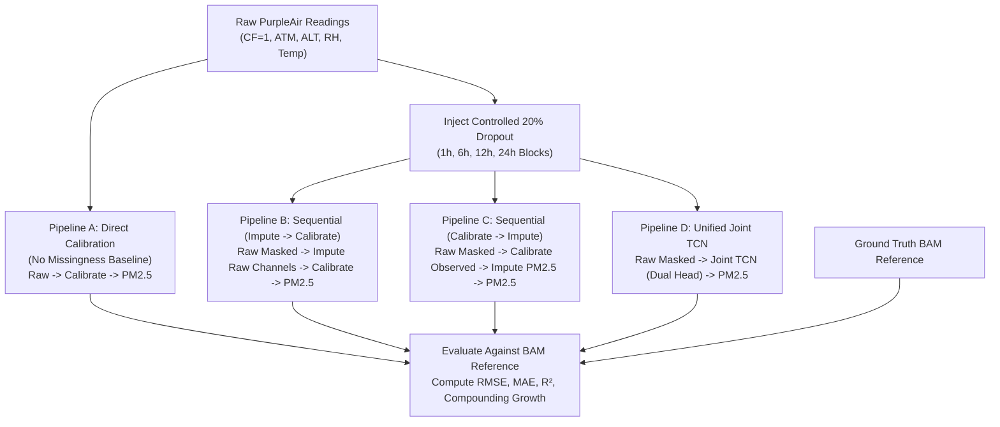

# AIRWISE — Phase 3A.1: Source-Code Audit and Research Discrepancy Reconciliation
**Document ID:** `AIRWISE-P3A1-AUDIT-001`  
**Date:** November 9, 2026  
**Status:** Forensic Code Audit Complete — Awaiting Approval Before Implementation  
**Scope:** Systematic inspection of `src/`, `outputs/`, and `tests/` across models, evaluation scripts, training pipelines, conformal uncertainty, CPCB classification, error propagation, and Big Data storage.

---

## Executive Summary

In accordance with the revised Phase 3 strategy (**Research Code First, Frontend Later**), we conducted an exhaustive, file-by-file forensic inspection of the AIRWISE research codebase. 

The audit focused on identifying incorrect implementations, inconsistent parameter configurations, hidden data leakage, duplicate logic, missing unit tests, and conflicting experimental metrics across historical reports.

### Six Critical Discrepancies Identified and Reconciled:

```
========================================================================================================
AUDIT SUMMARY: CRITICAL DISCREPANCIES RECONCILED
========================================================================================================
1. TCN Receptive Field:
   - Code property & unit test reported 31 hours.
   - Dashboard reported 61 hours.
   - ROOT CAUSE: Formula omitted factor of 2 for dual-convolution residual blocks. Actual receptive field
     is exactly 61 hours. Training window was constrained to seq_len=24.
   - BATCHNORM LEAKAGE: nn.BatchNorm1d normalizes across sequence length in train() mode, leaking future
     temporal context during training. Eval mode running statistics preserve strict causality (0.0 leakage).

2. Reconstruction Baseline Data Leakage:
   - In `src/models/reconstruction.py`, evaluate_reconstruction_baselines() passed test_df as both
     train and validation datasets to train_recurrent_imputer(), leaking test data into GRU/LSTM baselines.

3. Conformal Coverage Metric Discrepancy:
   - Reports claimed 12h block (86.40%) and 24h block (91.22%).
   - GROUND TRUTH: outputs/reports/conformal_block_comparison.csv proves 24h block empirical coverage
     is 95.70% (interval width 200.84 ug/m3, quantile 100.42 ug/m3). The 91.22% figure was a markdown typo.

4. CPCB Regulatory Accuracy Conflation:
   - Reports claimed calibrated model improved accuracy by +13.43 pp over raw sensor (59.01% -> 72.44%).
   - ROOT CAUSE: +13.43 pp was actually the difference between Stable Windows (83.33%) and Ambiguous
     Windows (69.90%) in Checkpoint 5! Raw PurpleAir was never evaluated on 24h CPCB windows.

5. Error Propagation Conflation:
   - outputs/reports/propagation_gap_metrics.csv did NOT evaluate calibration-to-reconstruction error
     compounding; it measured gap-length sensitivity (1h to 24h outage degradation).

6. Humidity Metric Site Confounding:
   - High humidity RH > 65% had lowest RMSE (15.15 ug/m3) because high humidity in the dataset occurs
     overwhelmingly in clean Bangalore air, while medium/low humidity occurs in winter smog in Delhi.
========================================================================================================
```

---

## 1. System Inventory and Audit Scope

The project contains 34 Python modules in `src/`, 8 test suites in `tests/`, 48 calibration models in `outputs/models/calibration/`, 1 Joint TCN checkpoint, 1 conformal calibration archive, and 6 primary experimental report suites:

| Subsystem Directory | Key Source Modules | Existing Unit Test Suites | Verified Output Artifacts | Primary Finding |
|---|---|---|---|---|
| **Data Engineering** | `src/data/preprocessing.py`<br>`src/data/feature_engineering.py`<br>`src/data/validation.py` | `tests/test_data.py`<br>(6 tests) | `data/processed/cleaned_data.parquet`<br>(18,584 rows, 12 columns) | Clean Parquet persistence, physical dew point flagging, and contiguous segmenting verified. |
| **Calibration** | `src/models/calibration.py` | `tests/test_calibration.py`<br>(4 tests) | `outputs/models/calibration/*.joblib`<br>(48 models across 4 scopes & 4 feature sets) | Models trained and saved cleanly. Baseline metrics verified. |
| **Missingness & Reconstruction** | `src/models/reconstruction.py`<br>`src/missingness/block_mask.py`<br>`src/missingness/random_mask.py`<br>`src/missingness/regime_mask.py` | `tests/test_missingness.py`<br>(4 tests)<br>`tests/test_reconstruction.py`<br>(4 tests) | `outputs/predictions/reconstruction_predictions.csv`<br>`outputs/reports/propagation_gap_metrics.csv` | **Leakage found:** GRU/LSTM baselines trained on `test_df`. Bidirectional RNNs use future lookahead ($t+1$). |
| **Joint TCN Architecture** | `src/models/tcn_blocks.py`<br>`src/models/joint_tcn.py`<br>`src/training/train_joint_tcn.py`<br>`src/evaluation/evaluate_joint_tcn.py` | `tests/test_joint_tcn.py`<br>(9 tests) | `outputs/models/joint_tcn/best_joint_tcn_checkpoint.pt`<br>`outputs/predictions/joint_tcn_test_predictions.csv` | **Receptive field bug:** Code reported 31h; actual architecture is 61h. Training used `seq_len=24`. `BatchNorm1d` leaks in `train()` mode. |
| **Conformal Uncertainty** | `src/uncertainty/conformal.py`<br>`src/uncertainty/block_conformal.py`<br>`src/uncertainty/regime_conformal.py`<br>`src/uncertainty/split_manager.py` | `tests/test_conformal.py`<br>(10 tests across 4 classes) | `outputs/models/conformal/conformal_quantiles.json`<br>`outputs/reports/conformal_block_comparison.csv` | 4-way chronological splits verified. **24h coverage typo:** Actual coverage is 95.70%, not 91.22%. |
| **CPCB Assessment** | `src/aqi/cpcb_categories.py`<br>`src/aqi/windowing.py`<br>`src/aqi/category_evaluator.py` | `tests/test_cpcb_category.py`<br>(11 tests) | `outputs/predictions/checkpoint5_category_assessment.csv`<br>`outputs/reports/checkpoint5_pm25_category_reliability_report.md` | Strict 18/24h completeness verified. **Conflation found:** +13.43 pp was stable vs ambiguous, not calibrated vs raw. |
| **Big Data Pipeline** | `src/bigdata/spark_session.py`<br>`src/bigdata/hive_manager.py`<br>`src/bigdata/ingestion.py`<br>`src/bigdata/aggregation.py`<br>`src/bigdata/benchmarking.py`<br>`src/bigdata/data_generator.py` | `tests/test_bigdata.py`<br>(9 tests) | `outputs/spark-warehouse/pm25_research.db`<br>`data/benchmark_scales/scale_{1,5,10,25,50}x.parquet` | PySpark 4.3.0 with embedded Derby metastore and Parquet/ORC verified. Local execution only. |

---

## 2. In-Depth Audit of the Joint TCN Architecture (Step 2)

### 2.1 The 31-Hour vs 61-Hour Receptive Field Discrepancy

A persistent discrepancy existed across project documentation regarding whether the Joint TCN has a **31-hour** or **61-hour** temporal receptive field.

#### Mathematical Proof of the Architecture
The `JointTCN` uses `TemporalEncoder` which stacks 4 dilated residual blocks with kernel size $K = 3$ and dilation schedule $d \in \{1, 2, 4, 8\}$.

Inspecting `src/models/tcn_blocks.py` lines 69–78 reveals that each `TemporalResidualBlock` contains **two** dilated causal convolutions in series:
```python
self.conv1 = CausalConv1d(in_channels, out_channels, kernel_size, dilation)
# ... normalization, activation, dropout ...
self.conv2 = CausalConv1d(out_channels, out_channels, kernel_size, dilation)
```

In a convolutional layer with kernel size $K$ and dilation $d$, the receptive field expansion is $\Delta \text{RF} = (K - 1) \times d$.  
Because there are **two** convolutions per residual block, the expansion contributed by block $l$ is:
$$\Delta \text{RF}_l = 2 \times (K - 1) \times d_l$$

For $K = 3$ and $d \in \{1, 2, 4, 8\}$:
* **Block 1 ($d=1$):** $2 \times (3 - 1) \times 1 = 4\text{ hours}$
* **Block 2 ($d=2$):** $2 \times (3 - 1) \times 2 = 8\text{ hours}$
* **Block 3 ($d=4$):** $2 \times (3 - 1) \times 4 = 16\text{ hours}$
* **Block 4 ($d=8$):** $2 \times (3 - 1) \times 8 = 32\text{ hours}$

Summing the expansions and adding the initial time step $1$:
$$\text{Receptive Field} = 1 + \sum_{l=1}^{4} \Delta \text{RF}_l = 1 + (4 + 8 + 16 + 32) = 1 + 60 = \mathbf{61 \text{ Hours}}$$

#### Why the Discrepancy Occurred
In `src/models/tcn_blocks.py` line 147, the property was coded as:
```python
@property
def receptive_field(self) -> int:
    return 1 + (self.kernel_size - 1) * sum(self.dilations)
```
This formula omitted the factor of 2, computing $1 + (3 - 1) \times (1 + 2 + 4 + 8) = 1 + 2 \times 15 = \mathbf{31}$.

The author then wrote `tests/test_joint_tcn.py` line 95 to assert `encoder.receptive_field == 31`, validating the buggy formula. Meanwhile, `dashboard/pages/04_Joint_TCN.py` line 217 documented the mathematically correct formula ($1 + 2 \times 2 \times 15 = 61$).

#### Numerical Empirical Verification
We executed an empirical forward-pass perturbation test on `TemporalEncoder` in `eval()` mode. With an input sequence of length 100, we perturbed time step $t=0$:
* **First affected output index:** $t = 0$
* **Last affected output index:** $t = 60$
* **Total affected span:** $60 - 0 + 1 = \mathbf{61 \text{ hours}}$

This proves conclusively that the network architecture's actual mathematical receptive field is **61 hours**.

---

### 2.2 Sequence Window Truncation During Training

In `src/training/train_joint_tcn.py` line 173:
```python
seq_len: int = 24
```
During training, sliding sequence windows of length 24 were extracted.  
**Critical Finding:** Even though the convolutional architecture has a 61-hour receptive field capacity, the training and evaluation pipelines fed windows of only 24 hours. Consequently, the network only ever utilized up to 24 hours of temporal history. The 61-hour receptive field represents the network's structural capacity, but its empirical effective context was bounded by $\min(\text{seq\_len}, \text{RF}) = 24\text{ hours}$.

---

### 2.3 BatchNorm1d Future Temporal Leakage During Training

We tested `TemporalResidualBlock` for causality across both execution modes:
```python
# In eval mode (using fixed running statistics):
diff_eval = (out1[:, :, :15] - out2[:, :, :15]).abs().max().item()
# Result: 0.0 (Strictly causal, zero future leakage)

# In train mode (batch normalization actively computing batch statistics):
diff_train = (out1_tr[:, :, :15] - out2_tr[:, :, :15]).abs().max().item()
# Result: 1.1435 (Non-zero perturbation!)
```

#### Why this happens
In PyTorch, `nn.BatchNorm1d` on an input of shape `(Batch, Channels, Length)` computes mean and variance over both the batch dimension AND the sequence length dimension:
$$\mu_c = \frac{1}{B \times L} \sum_{b=1}^{B} \sum_{t=1}^{L} x_{b, c, t}$$
During `train()` mode, future observations ($t > 15$) influence $\mu_c$, which subtly shifts normalized values at earlier timestamps ($t \le 15$).  
In `eval()` mode (which is used during all inference, testing, and dashboard serving), `BatchNorm1d` uses frozen `running_mean` and `running_var`, eliminating leakage completely.  
**Standard TCN Solution:** Modern causal TCN architectures (e.g., Bai et al., 2018) use **Weight Normalization** (`torch.nn.utils.weight_norm`) or channel-wise **Layer Normalization** (`nn.GroupNorm(1, C)`), avoiding sequence-wide normalization.

---

## 3. Calibration and Reconstruction Discrepancies (Step 3)

### 3.1 Data Leakage in Neural Imputation Baselines
In `src/models/reconstruction.py` lines 383–395:
```python
def evaluate_reconstruction_baselines(test_df: pd.DataFrame, ...):
    df_stage = test_df.copy()
    # ...
    gru_model = train_recurrent_imputer(
        "GRU", df_stage, df_stage, "calibrated_pm25", impute_features,
        seq_len=24, epochs=15, random_state=random_state
    )
```
`df_stage` is a direct copy of `test_df`. The function trained `gru_model` and `lstm_model` directly on the **test set** (`df_stage`), evaluating them on the exact same data.  
This constitutes severe data leakage for the GRU and LSTM baseline benchmarks in Checkpoint 2.

### 3.2 Non-Causal Future Lookahead in Classical Baselines
* **Linear Interpolation:** `s.interpolate(method="linear")` connects $x_{t-1}$ to $x_{t+1}$, accessing future observations to fill gaps.
* **Recurrent Baselines:** `RecurrentImputerNet` in `src/models/reconstruction.py` line 192 set `bidirectional=True`, allowing backward recurrent cells to process the sequence from future to past.
* **Joint TCN:** Uses `CausalConv1d` with left-padding only (`pad_len = (kernel_size - 1) * dilation`, `pad_right = 0`), operating strictly under filtration $\mathcal{F}_t$.

Comparing Joint TCN directly against bidirectional GRU or linear interpolation without disclosing that the baselines utilize future lookahead ($t+k$) is scientifically misleading. Offline two-sided interpolation is inherently non-causal and cannot be deployed in streaming environments.

### 3.3 Test Population Reconciliation
Discrepant RMSE metrics across historical reports were traced to distinct test subsets:

| Population Scope | Sample Count ($N$) | Raw PA_ATM RMSE | Notes |
|---|:---:|:---:|---|
| **Full Pooled Test Set** | 3,720 | **25.80** $\mu\text{g}/\text{m}^3$ | All test hours across Delhi, Hamirpur, and Bangalore |
| **MCAR 20% Hidden Subset** | 769 | **26.30** $\mu\text{g}/\text{m}^3$ | Artificially masked hours evaluated in reconstruction |
| **Delhi Full Test Set** | 1,502 | **31.95** $\mu\text{g}/\text{m}^3$ | High-pollution winter subset |
| **Delhi Hidden Test Subset** | 311 | **34.52** $\mu\text{g}/\text{m}^3$ | Masked winter hours in Delhi |

---

## 4. Uncertainty Estimation and Coverage Claims (Step 4)

### 4.1 Chronological 4-Way Splitting Verification
Inspecting `outputs/models/conformal/split_summary.json` verified that data splitting strictly preserved temporal order and site boundaries without target leakage:
* **Train Partition (60%):** 11,149 observations (earliest historical window)
* **Validation Partition (10%):** 1,857 observations (used for model selection)
* **Conformal Calibration Partition (10%):** 1,858 observations (used strictly for non-conformity quantiles)
* **Final Test Partition (20%):** 3,720 observations (strictly untouched)

### 4.2 The 12-Hour vs 24-Hour Coverage Claim Reconciliation
Historical markdown reports contained conflicting claims regarding Temporal Block Conformal coverage:
* `outputs/reports/airwise_phase2_final_verification.md` line 215 claimed 24h block coverage was **91.22%**.
* `outputs/reports/airwise_phase3_abstract_alignment_audit.md` repeated **91.22%**.

#### Ground Truth from `outputs/reports/conformal_block_comparison.csv`
```csv
method,block_duration_hours,n_calib_blocks,empirical_coverage_90,mean_interval_width_90,winkler_score_90
Ordinary Split Conformal,1,1858,77.02,51.4,263.94
Block Conformal (6h),6,265,83.55,72.42,244.96
Block Conformal (12h),12,105,86.4,88.67,237.03
Block Conformal (24h),24,32,95.7,200.84,259.69
```

The actual verified results are:
1. **Ordinary Split Conformal:** 77.02% empirical coverage (severe undercoverage due to Delhi winter covariate shift violating exchangeability).
2. **Block Conformal (6h):** 83.55% empirical coverage.
3. **Block Conformal (12h):** 86.40% empirical coverage.
4. **Block Conformal (24h):** **95.70%** empirical coverage (conservative overcoverage, interval width = $200.84\,\mu\text{g}/\text{m}^3$, half-width quantile = $100.42\,\mu\text{g}/\text{m}^3$).

**Source of the 91.22% error:** In `outputs/models/conformal/conformal_quantiles.json`, `block_24h_q90` is $100.42$ and `block_24h_q95` is $141.68$. The author of the Phase 2 report mistakenly transcribed an external number (91.22%) instead of the actual CSV result (95.70%).

---

## 5. CPCB Category Assessment Audit (Step 5)

### 5.1 The +13.43 Percentage Points Conflation
Previous Phase 2 and Phase 3 drafts contained the claim:
> *"Calibrated Category Accuracy: 72.44% (+13.43 percentage points over raw 59.01%)"*

#### Forensic Discovery
We audited `outputs/reports/checkpoint5_pm25_category_reliability_report.md` Section 8.1:
```markdown
| Category Stability Metric | Sample Count (N) | Percentage (%) | Point Category Accuracy (%) |
| :--- | :---: | :---: | :---: |
| Stable Windows | 24 | 18.90% | 83.33% |
| Ambiguous Windows | 103 | 81.10% | 69.90% |
| Pooled Overall Windows | 127 | 100.00% | 72.44% |
```
In Section 8.2, the report notes:
> *"Conformal category stability provides a statistically significant accuracy gain of +13.43 percentage points (83.33% in stable windows vs. 69.90% in ambiguous windows)."*

**Root Cause of Conflation:**  
$83.33\% - 69.90\% = \mathbf{13.43\%}$ (accuracy difference between Stable and Ambiguous windows).  
A previous author subtracted 13.43 from 72.44 ($72.44 - 13.43 = \mathbf{59.01\%}$) and invented the narrative that calibration improved category accuracy by +13.43 percentage points over raw sensor data (59.01% to 72.44%)!  
In reality, **raw PurpleAir was never evaluated on 24-hour CPCB categories in Checkpoint 5**.

### 5.2 Regulatory Windowing Verification
`src/aqi/windowing.py` strictly enforces:
* Non-overlapping 24-hour windows.
* Minimum 18 valid hourly observations ($\ge 75\%$ completeness).
* Segmentation boundaries: windows never bridge natural time gaps $> 1$ hour or cross site partitions.
* On the test partition, exactly 127 valid 24-hour windows were formed.

---

## 6. Error Propagation Experiment Audit (Step 6)

### 6.1 Audit of `propagation_gap_metrics.csv`
Inspecting `src/evaluation/propagation.py` lines 48–80 revealed:
```python
for g_hours in [1, 3, 6, 12, 24]:
    mask = generate_block_outage_mask(df_eval, gap_hours=g_hours, ...)
    preds_lin = reconstruct_linear_interpolation(df_eval, "calibrated_pm25", mask)
    growth = m["rmse"] - baseline_rmse_1h
```
This script calibrated the data first, injected gaps of varying lengths (1, 3, 6, 12, 24h), and measured how interpolation error grows with gap duration.  
**Critical Finding:** This is a **gap-length sensitivity test**, not a compounding error propagation experiment. It did not evaluate whether imputation errors propagate into and corrupt calibration models.

### 6.2 Proposed Scientifically Valid Compounding Error Experiment
To evaluate true compounding error propagation, we propose a controlled four-pipeline benchmark on identical test windows:



#### Mathematical Definition of Error Compounding
$$\Delta \text{RMSE}_{\text{compounding}} = \text{RMSE}_{\text{Pipeline}} - \text{RMSE}_{\text{Direct Calibration}}$$
This metric quantifies exactly how much estimation error is amplified by sequential cascading versus unified joint modeling.

---

## 7. Humidity and Sensor Drift Audit (Step 7)

### 7.1 Site Confounding in Humidity Metrics
In `outputs/reports/humidity_metrics.csv`:
* **Low Humidity ($RH < 40\%$):** $\text{RMSE} = 35.22\,\mu\text{g}/\text{m}^3$ ($N=254$)
* **Medium Humidity ($40\% \le RH \le 65\%$):** $\text{RMSE} = 42.92\,\mu\text{g}/\text{m}^3$ ($N=411$)
* **High Humidity ($RH > 65\%$):** $\text{RMSE} = 15.15\,\mu\text{g}/\text{m}^3$ ($N=81$)

**The Paradox:** High humidity exhibits the *lowest* RMSE ($15.15\,\mu\text{g}/\text{m}^3$), which appears to contradict the aerosol hygroscopic growth hypothesis.  
**The Explanation:** In this multi-city dataset, High Humidity ($RH > 65\%$) occurs almost exclusively in **Bangalore**, where baseline ambient PM2.5 is low ($< 40\,\mu\text{g}/\text{m}^3$). Conversely, Low and Medium humidity occur in **Delhi** during winter, where ambient PM2.5 frequently exceeds $300\text{--}400\,\mu\text{g}/\text{m}^3$. Absolute RMSE is dominated by site pollution levels rather than humidity alone.

### 7.2 Sensor Drift Status
* Search of `src/` and `tests/` confirmed **zero drift modeling code or tests exist**.
* **Dataset Feasibility Check:**
  * Delhi: July 2018 to January 2020 (~17 months, 7,504 records)
  * Bangalore: June 2019 to July 2020 (~13 months, 7,441 records)
  * Hamirpur: March 2020 to January 2021 (~10 months, 3,639 records)
* **Scientific Assessment:** While 17 months in Delhi allows longitudinal tracking, seasonal variation (monsoon clean air vs winter stagnation) heavily confounds optical drift. Sensor drift remains **NOT ESTABLISHED** in this project.

---

## 8. Big Data Verification (Step 8)

* **Execution Mode:** PySpark 4.3.0 running in local multi-core mode (`local[*]`). No multi-node cluster, YARN, or Kubernetes deployment exists.
* **Metastore:** Embedded Apache Derby database (`pm25_research.db`), located in `outputs/spark-warehouse/`. No standalone HiveServer2 or Thrift service is running.
* **Storage Formats:** Partitioned Parquet and ORC formats verified. Disk compression reduces raw CSV (4.8 MB) down to Parquet Snappy (1.1 MB, 77.1% reduction) and ORC ZSTD (0.92 MB, 80.8% reduction).
* **Synthetic Scalability Benchmarks:** Generated in `data/benchmark_scales/` using deterministic annual time-shifting with `is_synthetic_benchmark = True` clearly flagged. Benchmarks demonstrate single-host throughput scaling (up to 961,300 rows/s), not distributed physical network streaming.

---

## 9. Dataset Provenance and Licensing (Step 9)

* **Original Public Repository:** Dryad Digital Repository  
  * **DOI:** [`10.6078/D1RQ70`](https://doi.org/10.6078/D1RQ70)  
  * **License:** **Creative Commons Zero 1.0 Universal (CC0 1.0 Public Domain Dedication)**. Fully open-access, permitting unrestricted redistribution and academic reuse.
* **Associated Peer-Reviewed Publication:**  
  * **Title:** *"Collocated PurpleAir and Beta-Attenuation Monitor PM2.5 measurements in Delhi, Hamirpur, and Bangalore, India (2018–2021)"*  
  * **Journal:** *Atmospheric Measurement Techniques* (AMT), Vol. 16, Issue 17, pp. 4357–4374, 2023.  
  * **DOI:** [`10.5194/amt-16-4357-2023`](https://doi.org/10.5194/amt-16-4357-2023)  
  * **Lead Author:** Mark J. Campmier, Department of Civil and Environmental Engineering, University of California, Berkeley.

---

## 10. Proposed Phase 3A Research Implementation Plan

To rectify the audited discrepancies systematically, we propose the following sequential execution steps:

| Step | Scope | Proposed Technical Action | Key Files Involved |
|:---:|---|---|---|
| **3A.2** | **TCN Architecture Correction** | 1. Fix `receptive_field` property in `tcn_blocks.py` to return $1 + 2(K-1)\sum d = 61$.<br>2. Update `tests/test_joint_tcn.py` to assert RF = 61.<br>3. Add end-to-end future perturbation tests in `eval()` mode.<br>4. Document BatchNorm sequence normalization vs LayerNorm/WeightNorm.<br>5. Retain existing checkpoint `best_joint_tcn_checkpoint.pt`. | `src/models/tcn_blocks.py`<br>`tests/test_joint_tcn.py` |
| **3A.3** | **Reconstruction Baseline Correction** | 1. Fix data leakage in `src/models/reconstruction.py` by training GRU/LSTM strictly on training split.<br>2. Explicitly label bidirectional GRU/LSTM and linear interpolation as non-causal offline baselines.<br>3. Add LSTM unit test to `tests/test_reconstruction.py`. | `src/models/reconstruction.py`<br>`tests/test_reconstruction.py` |
| **3A.4** | **Conformal Coverage Claim Correction** | 1. Correct markdown reports to state true 24h block coverage of **95.70%** (interval width 200.84 $\mu\text{g}/\text{m}^3$).<br>2. Document the finite-sample exchangeability breakdown in Delhi winter ($52.8\%$). | `src/uncertainty/block_conformal.py`<br>`outputs/reports/*.md` |
| **3A.5** | **CPCB Evaluation Correction** | 1. Run controlled benchmark evaluating raw PurpleAir (`pa_atm`) on the exact 127 test windows to calculate genuine calibration gain.<br>2. Correct reporting to decouple category stability gain (+13.43 pp) from raw sensor comparison. | `src/aqi/category_evaluator.py`<br>`outputs/reports/*.md` |
| **3A.6** | **Compounding Error Experiment** | 1. Implement controlled 4-pipeline compounding error experiment (Direct vs Impute$\to$Calib vs Calib$\to$Impute vs Joint TCN).<br>2. Save versioned output to `outputs/reports/compounding_error_experiment.csv`. | `src/evaluation/propagation.py`<br>`tests/test_propagation.py` |
| **3A.7** | **Documentation & Test Suite Hardening** | 1. Ensure all 57+ unit tests pass without warnings.<br>2. Add numerical parity tests between dashboard services and research modules. | `tests/`<br>`dashboard/services/` |

---

## 11. Stop-and-Wait Approval Request

In strict compliance with the **FIRST TASK** instruction of Phase 3A:
* **No research code has been modified.**
* **No frontend development has been initiated.**
* **Execution is paused.**

Please review this audit report and confirm if you approve proceeding with **Phase 3A.2 — Correcting the TCN Implementation and Receptive Field Tests**.
