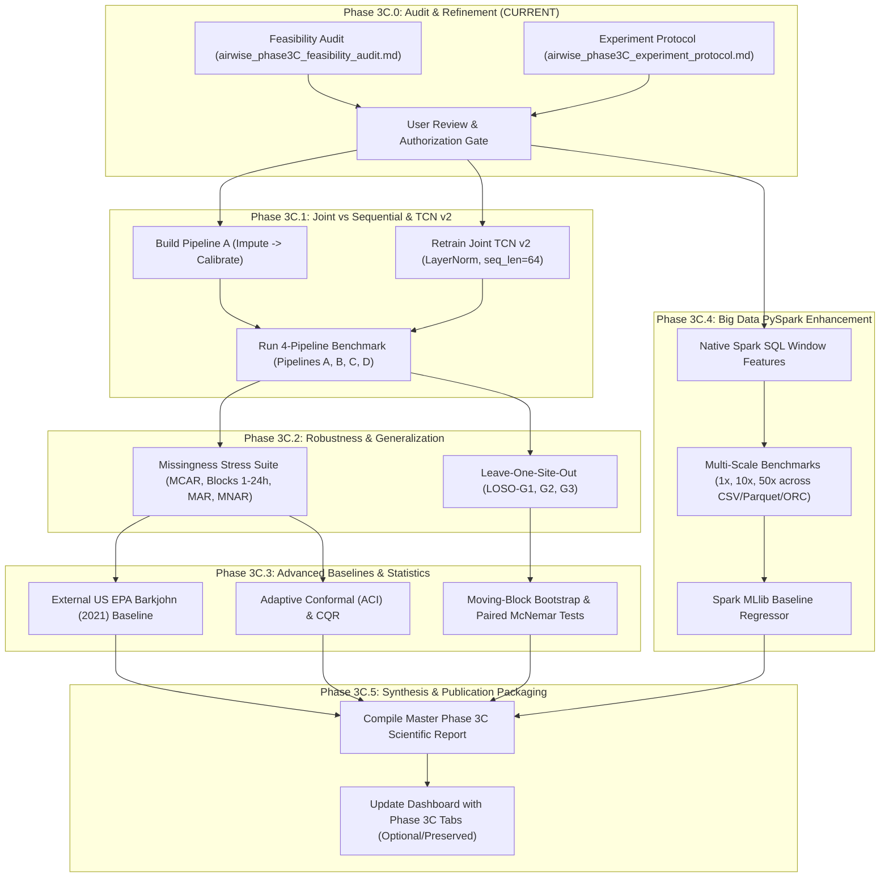

# AIRWISE — Phase 3C.0: Enhanced Research Experiment Protocol & Specification (Refined v5)

**Document ID:** `AIRWISE-P3C-PROTOCOL-005`  
**Date:** November 9, 2026  
**Status:** Protocol Formally Clarified & Approved for Review (Pre-Execution Gate)  
**Execution Restriction:** AUDIT AND DESIGN ONLY. No experimental runs, model retraining, checkpoint modifications, or prediction file overwrites have been executed.

---

## 1. Experimental Philosophy & Research Hypotheses

Phase 3C establishes the comprehensive experimental protocol designed to elevate the AIRWISE framework to top-tier conference- and journal-ready publication standard. The experimental design rigorously evaluates the interplay between **physical sensor degradation, multi-task temporal deep learning, non-exchangeable conformal uncertainty, regulatory compliance, and distributed big-data feature engineering**.

### Formal Research Hypotheses

* **Hypothesis 1 ($H_1$ — Joint Representation Advantage):** Joint multi-task representation learning (Pipeline C) achieves superior reconstruction of missing air quality measurements on reference BAM ground truth compared to two-stage sequential pipelines (Pipeline A: Impute $\to$ Calibrate and Pipeline B: Calibrate $\to$ Impute) by learning shared latent representations that capture coupled particulate and meteorological dynamics.
* **Hypothesis 2 ($H_2$ — Causality-Safe Receptive Field Realization):** A causality-safe Joint TCN trained with `ChannelLayerNorm1d` and exposed to a sequence length sufficient to realize its full analytical receptive field ($RF = 61\text{h}$) outperforms causal sequential recurrent models (Causal GRU, Causal LSTM) and matches or exceeds the historical BatchNorm checkpoint without any future sequence leakage.
* **Hypothesis 3 ($H_3$ — Structural Missingness Degradation):** As missingness transitions from Missing Completely At Random (MCAR) to Missing at Random (MAR conditioned on observed covariates) and Missing Not At Random (MNAR conditioned on particulate intensity), two-stage sequential pipelines suffer severe error propagation, whereas Joint TCN demonstrates significantly more robust degradation.
* **Hypothesis 4 ($H_4$ — Geographical & Climatological Domain Transfer):** Spatial transferability across distinct Indian airsheds without local retraining is asymmetric: models trained on high-pollution northern plains (Delhi) generalize moderately to cleaner southern plateaus (Bangalore), but models trained on clean southern airsheds collapse when transferred to extreme northern winter inversions.
* **Hypothesis 5 ($H_5$ — Western Calibration Transfer Divergence):** The published US EPA PurpleAir correction equation (Barkjohn et al. 2021) exhibits significant error when directly applied to Indian sensor data, demonstrating empirically that empirical Western calibration equations cannot be directly transferred to South Asian airsheds.
* **Hypothesis 6 ($H_6$ — Adaptive Uncertainty Dynamics):** Online prequential Adaptive Conformal Inference (ACI) dynamically adjusts nonconformity thresholds to track non-stationary regimes, providing improved temporal coverage tracking compared to static split conformal calibration during seasonal transition episodes.
* **Hypothesis 7 ($H_7$ — In-Engine Big Data Efficiency):** Moving temporal rolling and lag feature engineering into native Spark SQL window functions eliminates JVM-Python serialization overhead and demonstrates superlinear throughput gains over Pandas as dataset volume scales from 1x to 50x.

---

## 2. Protocol 1 — Joint versus Sequential Pipeline Comparison

### 2.1 Critical Methodological Separation: Input Missingness ($M_X$) versus Target BAM Data Roles

A central flaw in naive sensor benchmarks is conflating missing input measurements with withheld evaluation ground truth. In environmental cyber-physical systems, these represent fundamentally distinct concepts:

```
┌──────────────────────────────────────────────────────────────────────────────────────────────────┐
│                            INPUT MASK (M_X) vs TARGET BAM DATA ROLES                             │
├───────────────────────────────┬──────────────────────────────────────────────────────────────────┤
│ Feature-Level Input Mask      │ M_X ∈ {0, 1}^{N × C} identifies channel-specific availability.   │
│                               │ M_X,t,c = 1: Feature channel c is observed at time t.            │
│                               │ M_X,t,c = 0: Feature channel c is missing at time t.             │
├───────────────────────────────┼──────────────────────────────────────────────────────────────────┤
│ Timestep PM Indicator         │ m_t^PM = ∏_{c ∈ {cf1, atm, alt}} M_X,t,c ∈ {0, 1}                 │
│                               │ Controls TCN calibration vs reconstruction head supervision.     │
├───────────────────────────────┼──────────────────────────────────────────────────────────────────┤
│ Reference BAM Target Roles    │ Four distinct roles across the four canonical partitions:        │
│                               │ 1. Training BAM: Parameter fitting (Huber backpropagation).      │
│                               │ 2. Validation BAM: Model selection & early stopping.             │
│                               │ 3. Conformal Calibration BAM: Post-prediction quantile scores.   │
│                               │ 4. Test BAM: Final unbiased evaluation harness ground truth.     │
└───────────────────────────────┴──────────────────────────────────────────────────────────────────┘
```

#### Four Explicit BAM Data Roles
To resolve any ambiguity regarding target "withholding":
1. **Training BAM ($Y_{\text{train}}$ on `train_df`, $N=11,149$):** Used for model parameter fitting via gradient descent (Huber loss minimization). It provides supervision for calibration and reconstruction heads. **It is never passed as an input feature to the network.**
2. **Validation BAM ($Y_{\text{val}}$ on `val_model_df`, $N=1,857$):** Used strictly for model selection, hyperparameter tuning, and early stopping. It evaluates generalization error on out-of-sample sequences. **It is never accessible to the model as an input feature and never used for backpropagation parameter updates.**
3. **Conformal Calibration BAM ($Y_{\text{calib}}$ on `calib_conformal_df`, $N=1,858$):** Used *strictly post-prediction* by the conformal calibration engine to calculate nonconformity scores $s_i = |y_i - \hat{y}_i|$. **It is never used for parameter fitting, architecture selection, or early stopping, and is never fed as an input feature.**
4. **Test BAM ($Y_{\text{test}}$ on `test_df`, $N=3,720$):** Completely inaccessible during all phases of model development, training, validation, tuning, and calibration. Used exclusively by the independent evaluation harness to compute unbiased benchmark metrics (RMSE, MAE, $R^2$, Winkler score, CPCB accuracy).

> [!IMPORTANT]
> **Ground Truth Withholding Principle:** Withholding a target from model inputs means strictly that the true ground-truth value is excluded from the model's feature set ($X_t$). It does *not* mean the evaluator cannot use its ground truth for the designated evaluation purpose (computing validation loss, conformal quantiles, or test metrics).

---

### 2.2 Feature-Level Mask ($M_X$) and Timestep-Level Indicator ($m_t^{\text{PM}}$)

#### Mathematical Formulation
Input missingness is defined at the feature level across $C = 10$ input channels (or $C = 11$ when the mask indicator is appended):
* **PM2.5 Sensor Channels ($\mathcal{C}_{\text{PM}}$):** `pa_cf1`, `pa_atm`, `pa_alt`.
* **Meteorological Channels ($\mathcal{C}_{\text{meteo}}$):** `relative_humidity`, `temperature`.
* **Cyclical Calendar Harmonics ($\mathcal{C}_{\text{time}}$):** `hour_sin`, `hour_cos`, `day_of_year_sin`, `day_of_year_cos`, `time_diff_hours`.

The **timestep-level PM availability indicator** is defined as the product across all three PM channels:
$$m_t^{\text{PM}} = \prod_{c \in \mathcal{C}_{\text{PM}}} M_{X, t, c} = \mathbb{I}\left(M_{X, t, \text{cf1}} = 1 \land M_{X, t, \text{atm}} = 1 \land M_{X, t, \text{alt}} = 1\right)$$

The **complete station availability indicator** is defined as:
$$m_t^{\text{station}} = \prod_{c \in \mathcal{C}_{\text{PM}} \cup \mathcal{C}_{\text{meteo}}} M_{X, t, c}$$

#### Explicit Treatment across Outage Scenarios

```
┌────────────────────────────────────────────────────────────────────────────────────────────────────────┐
│                              OUTAGE SCENARIO TREATMENT & HEAD SUPERVISION                              │
├─────────────────────────┬──────────┬─────────────┬──────────────────────────┬──────────────────────────┤
│ Outage Scenario         │ m_t^PM   │ m_t^station │ Calibration Head Superv. │ Reconstruct Head Superv. │
├─────────────────────────┼──────────┼─────────────┼──────────────────────────┼──────────────────────────┤
│ 1. All 3 PM Observed    │ 1        │ 1           │ Active (L_cal evaluated) │ Masked Out (Weight = 0)  │
│ 2. 1 or 2 PM Missing    │ 0        │ 0           │ Masked Out (Weight = 0)  │ Active (L_rec evaluated) │
│ 3. All 3 PM Missing     │ 0        │ 1 (meteo on)│ Masked Out (Weight = 0)  │ Active (L_rec evaluated) │
│ 4. Total Station Outage │ 0        │ 0           │ Masked Out (Weight = 0)  │ Active (L_rec evaluated) │
└─────────────────────────┴──────────┴─────────────┴──────────────────────────┴──────────────────────────┘
```

1. **Scenario 1: All three PM channels observed ($m_t^{\text{PM}} = 1$, meteorology observed):**
   - *Calibration Head:* Supervised. Huber loss $\mathcal{L}_{\text{cal}}$ computed against $Y_{\text{BAM}, t}$.
   - *Reconstruction Head:* Inactive/masked out. Huber loss $\mathcal{L}_{\text{rec}}$ has weight 0.
   - *Composite Output:* $\hat{Y}_{\text{final}, t} = \hat{Y}_{\text{cal}, t}$.
2. **Scenario 2: One or two PM channels missing ($m_t^{\text{PM}} = 0$, partial PM corruption):**
   - *Treatment:* Standard calibration models require the full uncorrupted sensor triplet (`pa_cf1`, `pa_atm`, `pa_alt`) to predict calibrated PM2.5. Partial PM channel absence invalidates direct unassisted calibration.
   - *Pipeline A (Impute $\to$ Calibrate):* Multi-channel imputer $f_{\text{imp}}$ imputes the 1 or 2 missing PM channels first from the observed PM channel(s) and meteorology. Once completed, the calibration model predicts $\hat{Y}_{A, t}$.
   - *Pipeline C (Joint TCN v2):* $m_t^{\text{PM}} = 0$. The missing PM channels are zeroed in the input tensor ($X_t \odot M_{X, t}$), the mask indicator channel reflects the dropout, and this timestep is assigned to the **Reconstruction Head** (supervising $\mathcal{L}_{\text{rec}}$ against $Y_{\text{BAM}, t}$). The calibration head output is masked out to prevent corrupted calibration estimates.
3. **Scenario 3: All three PM channels missing ($m_t^{\text{PM}} = 0$, meteorology available):**
   - Low-cost PM channels zeroed: $X_{\text{PM}, t} = 0$. Meteorology (`relative_humidity`, `temperature`) and cyclical harmonics remain available.
   - *Calibration Head:* Inactive/masked out ($\mathcal{L}_{\text{cal}}$ weight = 0).
   - *Reconstruction Head:* Supervised. Huber loss $\mathcal{L}_{\text{rec}}$ computed against $Y_{\text{BAM}, t}$ using temporal context and available meteorology.
   - *Composite Output:* $\hat{Y}_{\text{final}, t} = \hat{Y}_{\text{rec}, t}$.
4. **Scenario 4: Complete station outage ($m_t^{\text{station}} = 0$, total telemetry blackout):**
   - All physical features zeroed: $X_{\text{PM}, t} = 0, X_{\text{meteo}, t} = 0$. Only deterministic calendar harmonics (`hour_sin`, `hour_cos`, `day_of_year_sin`, `day_of_year_cos`, `time_diff_hours`) remain available.
   - *Calibration Head:* Inactive/masked out ($\mathcal{L}_{\text{cal}}$ weight = 0).
   - *Reconstruction Head:* Supervised. Huber loss $\mathcal{L}_{\text{rec}}$ computed against $Y_{\text{BAM}, t}$ using purely historical temporal representations and cyclical harmonics.
   - *Composite Output:* $\hat{Y}_{\text{final}, t} = \hat{Y}_{\text{rec}, t}$.

#### Prevention of Unmasked Calibration Leakage
In `ReconstructionHead.forward(h, y_cal, mask)`:
$$\hat{Y}_{\text{cal\_observed}, t} = \hat{Y}_{\text{cal}, t} \times m_t^{\text{PM}}$$
When $m_t^{\text{PM}} = 0$, $\hat{Y}_{\text{cal\_observed}, t} = 0$ identically. This mathematically guarantees that the reconstruction head **never receives an unmasked calibration estimate at a missing timestep**, preventing corrupt/zeroed calibration artifacts from leaking into reconstruction.

* **Historical 20% MCAR Preservation:** The historical Checkpoint 3/4 benchmark (which zeroed `pa_cf1`, `pa_atm`, `pa_alt` while evaluating BAM error on those timestamps) is preserved as an explicit reference scenario: **"Historical Joint Masking (Simulated Sensor Dropout with Concurrent BAM Evaluation)"**.

---

### 2.3 Detailed Pipeline Architectures & Information Accounting

```
┌──────────────────────────────────────────────────────────────────────────────────────────────────┐
│                                   PIPELINE ARCHITECTURE COMPARISON                               │
├──────────────────────────────────────────────────────────────────────────────────────────────────┤
│ Pipeline A (Impute ──> Calibrate):                                                               │
│   X_t [Masked Channels, m_t^PM=0] ──> Multi-Channel Imputer ──> X_completed,t ──> Calib Head ──> BAM│
├──────────────────────────────────────────────────────────────────────────────────────────────────┤
│ Pipeline B (Calibrate ──> Impute):                                                               │
│   X_t [Observed, m_t^PM=1] ──> Calib Head ──> Y_cal,t [Masked] ──> Imputation Baseline ──> BAM     │
├──────────────────────────────────────────────────────────────────────────────────────────────────┤
│ Pipeline C (Joint Multi-Task TCN v2):                                                            │
│   [X_t ⊙ M_X, M_X, Meteo] ──> Shared Causal Temporal Encoder ──> [Cal Head, Rec Head] ──> BAM   │
├──────────────────────────────────────────────────────────────────────────────────────────────────┤
│ Pipeline D (Complete-Case Calibration Reference):                                                │
│   X_t [m_t^PM = 1 Only] ──> Calibration Head ──> Evaluated on observed points; missing dropped  │
└──────────────────────────────────────────────────────────────────────────────────────────────────┘
```

#### Detailed Specification per Pipeline

| Pipeline Specification | Pipeline A (Impute $\to$ Calibrate) | Pipeline B (Calibrate $\to$ Impute) | Pipeline C (Joint TCN v2) | Pipeline D (Complete-Case Reference) |
|---|---|---|---|---|
| **Input Channels Available (Partial Outage)** | Meteorology (RH, Temp) + calendar harmonics when $m_{t}^{\text{PM}}=0$; all channels when $m_{t}^{\text{PM}}=1$. | All channels when $m_{t}^{\text{PM}}=1$; none for direct calibration when $m_{t}^{\text{PM}}=0$. | Full feature tensor $[X_t \odot M_{X,t}, M_{X,t}, \text{Meteo}_t]$. | Full channels strictly when $m_{t}^{\text{PM}}=1$. |
| **Input Channels Available (Complete Blackout)** | Only deterministic calendar harmonics when $m_t^{\text{station}}=0$. | None for direct calibration when $m_t^{\text{station}}=0$. | Feature tensor $[0, M_{X,t}, \text{Harmonics}_t]$. | Full channels strictly when $m_t^{\text{station}}=1$. |
| **Artificially Missing Channels** | Channels where $M_{X,t,c} = 0$. | Channels where $M_{X,t,c} = 0$. | Channels where $M_{X,t,c} = 0$ (zeroed out). | All channels where $M_{X,t,c} = 0$. |
| **Reconstruction Mechanism** | Multi-channel imputer $f_{\text{imp}}$ (fitted strictly on `train_df`) reconstructs raw channels $\tilde{X}_t$. | Calibrates observed points first ($\hat{Y}_{\text{cal},t}$); then time-series imputer $h_{\text{recon}}$ reconstructs missing predictions. | Dedicated **Reconstruction Head** conditioned on shared temporal representation $H_t$, masked calibration estimate, and $M_{X,t}$. | **None.** Missing inputs are **not silently imputed**. Missing periods produce no prediction. |
| **BAM Reference Access** | Used strictly on `train_df` to fit calibration regressor $g_{\text{cal}}$. Never accessible at test inference. | Used strictly on `train_df` to fit $g_{\text{cal}}$. Never used to fit $h_{\text{recon}}$ on test data. | Accessible on `train_df` during training to compute multi-task Huber loss. Never accessible at test inference. | Used strictly on `train_df` complete cases to fit $g_{\text{cal}}$. Never accessible at test inference. |
| **Evaluation Timestamps** | Evaluated on all test BAM timestamps ($N=3,720$). Separate metrics on $m_t^{\text{PM}}=0$ and $m_t^{\text{PM}}=1$. | Evaluated on all test BAM timestamps ($N=3,720$). Separate metrics on $m_t^{\text{PM}}=0$ and $m_t^{\text{PM}}=1$. | Evaluated on all test BAM timestamps ($N=3,720$). Separate metrics on $m_t^{\text{PM}}=0$ (reconstruction) and $m_t^{\text{PM}}=1$ (calibration). | Evaluated **strictly on its eligible observed subset** ($m_t^{\text{PM}}=1$, $N \approx 2,976$). |
| **Prediction Availability / Coverage** | **100% Coverage** (predicts at all $N=3,720$ test timestamps). | **100% Coverage** (predicts at all $N=3,720$ test timestamps). | **100% Coverage** (predicts at all $N=3,720$ test timestamps). | **Partial Coverage:** $(1 - \text{missing\_rate}) \times 100\%$ (e.g. 80.0% coverage under 20% missingness). **0% on $m_t^{\text{PM}}=0$**. |

---

### 2.4 Fair Comparison Protocol & Selection Bias Accounting

1. **Eligible Evaluation Subsets:**
   - For evaluating **Reconstruction on Missing Data ($m_t^{\text{PM}} = 0$, $N \approx 744$)**: Pipelines A, B, and C are evaluated on the exact same timestamps against ground-truth reference BAM. Pipeline D **cannot predict here**; its availability is explicitly reported as 0.0%.
   - For evaluating **Calibration on Observed Data ($m_t^{\text{PM}} = 1$, $N \approx 2,976$)**: Pipelines A, B, C, and D are evaluated on the exact same timestamps against ground-truth reference BAM.
   - For evaluating **End-to-End Operational Pipeline ($N = 3,720$)**: Pipelines A, B, and C produce full time series. For Pipeline D, sequence-level metrics and 24-hour CPCB aggregations drop days with $< 18/24\text{h}$ complete data, quantifying the regulatory non-compliance penalty.
2. **Selection Bias Disclosure for Pipeline D:**
   - Complete cases ($m_t^{\text{PM}} = 1$) may not be representative of missing periods ($m_t^{\text{PM}} = 0$). If dropouts occur during extreme pollution or high humidity, evaluating solely on complete cases introduces selection bias. Pipeline D is formally presented as a **Complete-Case Calibration Reference**, not an "upper bound".

---

## 3. Protocol 2 — Causality-Safe Joint TCN v2 Retraining

### 3.1 Architectural Specifications & Sequence Length Decision

```
┌─────────────────────────────────────────────────────────────────────────────────────────┐
│                               JOINT TCN v2 CAUSALITY SPECIFICATION                      │
├───────────────────────────────┬─────────────────────────────────────────────────────────┤
│ Backbone Architecture         │ Dilated Causal Conv1D with Residual Connections        │
│ Normalization Layer           │ ChannelLayerNorm1d (Strictly Causal in Train & Eval)   │
│ Residual Blocks               │ 4 Blocks with Dilations [1, 2, 4, 8]                    │
│ Convolution Kernel Size (K)   │ 3                                                       │
│ Convolutions per Block        │ 2 (CausalConv1d with Left Padding = (K - 1) * d)       │
│ Analytical Receptive Field    │ RF = 1 + 2 * (3 - 1) * (1 + 2 + 4 + 8) = 61 Hours       │
│ Primary Sequence Length       │ seq_len = 64 Hours (Strictly exceeds RF = 61h)          │
│ Sensitivity Sequence Length   │ seq_len = 72 Hours (3 Complete Diurnal Cycles)          │
│ Hidden Channels               │ 32                                                      │
│ Trainable Parameters          │ 32,963                                                  │
│ Dropout Rate                  │ 0.15                                                    │
│ Activation Function           │ GELU                                                    │
│ Task Loss Function            │ Joint Multi-Task Huber Loss (lambda_cal=1.0, rec=1.0)   │
│ Optimizer                     │ AdamW (lr=1e-3, weight_decay=1e-4)                      │
│ Learning Rate Scheduler       │ ReduceLROnPlateau (factor=0.5, patience=5)              │
│ Early Stopping                │ Patience = 12 epochs on validation loss                 │
└───────────────────────────────┴─────────────────────────────────────────────────────────┘
```

#### Sequence Length Justification (`seq_len = 64\text{h}` vs `72\text{h}`)
* **Primary Choice (`seq_len = 64\text{h}`):**
  1. *Analytical Exposure:* Theoretical $RF = 61\text{h}$. Setting `seq_len = 64\text{h}` satisfies $L \ge RF$, ensuring every dilation layer operates without window truncation.
  2. *Sample Density:* As audited from `cleaned_data.parquet`, `train_df` contains **1,906 contiguous 64-hour windows** (compared to 1,714 for 72h), providing ~11% more valid training sequences and lower fragmentation near natural segment boundaries.
  3. *Unverified Hardware Hypothesis Note:* While power-of-two tensor dimensions are often hypothesized to offer memory alignment advantages on modern accelerator hardware, this remains an **unverified hypothesis** in our workstation environment. The definitive justification for $L = 64$ is that $64 > 61$, strictly exposing the full theoretical receptive field while maximizing available training sequences.
* **Sensitivity Sweep (`seq_len = 72\text{h}`):** Evaluated as a secondary sensitivity comparison to determine whether capturing exactly three 24-hour diurnal cycles ($3 \times 24\text{h}$) yields measurable predictive advantage over 64h.

---

### 3.2 Specification of TCN v2 Reconstruction Training & Multi-Task Supervision

During Joint TCN v2 training, the dual prediction heads are trained simultaneously under artificial missingness:
1. **Dynamic Training Mask Generation:**
   - In `TCNWindowDataset`, each training window of length $L = 64$ receives an artificial binary mask $M_{X, t} \in \{0, 1\}^L$ drawn with missing rates uniformly distributed between 5% and 30%.
   - At masked steps ($m_t^{\text{PM}} = 0$), the low-cost sensor channels (`pa_cf1`, `pa_atm`, `pa_alt`) are zeroed: $X_{\text{sensor}, t} \odot M_{X, t}$.
   - Exogenous meteorology and calendar harmonics remain unmasked unless simulating total station outage.
   - The binary mask indicator vector $M_{X, t}$ is concatenated as an explicit feature channel (channel dimension $D = 11$).
2. **Calibration Head Supervision:**
   $$\mathcal{L}_{\text{cal}} = \frac{1}{\sum_t m_t^{\text{PM}}} \sum_{t: m_t^{\text{PM}} = 1} \ell_{\text{Huber}}(\hat{Y}_{\text{cal}, t}, Y_{\text{BAM}, t})$$
   Evaluated **exclusively on observed positions**, supervising the calibration head on valid sensor readings.
3. **Reconstruction Head Supervision:**
   $$\mathcal{L}_{\text{rec}} = \frac{1}{\sum_t (1 - m_t^{\text{PM}})} \sum_{t: m_t^{\text{PM}} = 0} \ell_{\text{Huber}}(\hat{Y}_{\text{rec}, t}, Y_{\text{BAM}, t})$$
   Conditioned on shared representation $H_t$, masked calibration estimate $\hat{Y}_{\text{cal}, t} \times m_t^{\text{PM}}$, and $M_{X, t}$. Evaluated **exclusively on artificially hidden positions**, supervising the reconstruction head to predict reference BAM PM2.5 using exclusively temporal context and available covariates.
4. **Multi-Task Loss Combination:**
   $$\mathcal{L}_{\text{joint}} = \lambda_{\text{cal}} \mathcal{L}_{\text{cal}} + \lambda_{\text{rec}} \mathcal{L}_{\text{rec}} \quad (\lambda_{\text{cal}} = 1.0, \lambda_{\text{rec}} = 1.0)$$
5. **Target Exclusion from Inputs:**
   - $Y_{\text{BAM}}$ is never passed into the network. It enters solely through the Huber loss function at the output heads during backpropagation.

---

### 3.3 Strengthened Causality Verification Acceptance Criteria

To rigorously verify that Joint TCN v2 is free of temporal sequence leakage, the model must pass a comprehensive causality verification suite across multiple perturbation magnitudes, multiple cut points, both output heads, and both execution modes:

```python
def test_comprehensive_future_perturbation_causality(
    model: JointTCN,
    seq_len: int = 64,
    cut_positions: List[int] = [16, 32, 48, 60],
    perturbation_magnitudes: List[float] = [0.1, 10.0, 100.0, 500.0, -50.0],
    float32_tolerance: float = 1e-6,
):
    """
    Executes Test A (Value Perturbation with Fixed Mask) and Test B (Mask Perturbation with Fixed Values).
    Evaluates:
      - Multiple perturbation magnitudes (-50 to +500 ug/m3)
      - Multiple future cut positions (t0 in [16, 32, 48, 60])
      - Both output heads (cal, rec) and composite output (final)
      - Both training mode (model.train()) and evaluation mode (model.eval())
      - Float32 machine precision bound (tolerance = 1.0e-6)
    """
    for m in model.modules():
        if isinstance(m, torch.nn.Dropout):
            m.p = 0.0

    B, D, L = 4, 11, seq_len
    x_base = torch.randn(B, D, L)
    mask_base = torch.ones(B, 1, L)

    for mode in ["eval", "train"]:
        if mode == "train":
            model.train()
        else:
            model.eval()

        with torch.set_grad_enabled(mode == "train"):
            y_cal_base, y_rec_base, y_fin_base = model(x_base.clone(), mask_base.clone())

            for t0 in cut_positions:
                # -------------------------------------------------------------
                # TEST A: Value Perturbation across Multiple Magnitudes
                # -------------------------------------------------------------
                for delta in perturbation_magnitudes:
                    x_pert_a = x_base.clone()
                    x_pert_a[:, :, t0:] += delta
                    y_cal_a, y_rec_a, y_fin_a = model(x_pert_a, mask_base.clone())

                    dev_cal = torch.max(torch.abs(y_cal_base[:, :t0] - y_cal_a[:, :t0])).item()
                    dev_rec = torch.max(torch.abs(y_rec_base[:, :t0] - y_rec_a[:, :t0])).item()
                    dev_fin = torch.max(torch.abs(y_fin_base[:, :t0] - y_fin_a[:, :t0])).item()

                    assert dev_cal <= float32_tolerance, f"Test A Cal Head Leakage at t0={t0}, delta={delta}: {dev_cal}"
                    assert dev_rec <= float32_tolerance, f"Test A Rec Head Leakage at t0={t0}, delta={delta}: {dev_rec}"
                    assert dev_fin <= float32_tolerance, f"Test A Final Leakage at t0={t0}, delta={delta}: {dev_fin}"

                # -------------------------------------------------------------
                # TEST B: Mask Perturbation with Fixed Input Values
                # -------------------------------------------------------------
                mask_pert_b = mask_base.clone()
                mask_pert_b[:, :, t0:] = 0.0  # Flip future mask states
                y_cal_b, y_rec_b, y_fin_b = model(x_base.clone(), mask_pert_b)

                dev_cal_b = torch.max(torch.abs(y_cal_base[:, :t0] - y_cal_b[:, :t0])).item()
                dev_rec_b = torch.max(torch.abs(y_rec_base[:, :t0] - y_rec_b[:, :t0])).item()
                dev_fin_b = torch.max(torch.abs(y_fin_base[:, :t0] - y_fin_b[:, :t0])).item()

                assert dev_cal_b <= float32_tolerance, f"Test B Cal Head Leakage at t0={t0}: {dev_cal_b}"
                assert dev_rec_b <= float32_tolerance, f"Test B Rec Head Leakage at t0={t0}: {dev_rec_b}"
                assert dev_fin_b <= float32_tolerance, f"Test B Final Leakage at t0={t0}: {dev_fin_b}"
```

#### Acceptance Criteria & Scope Qualification
* **Numerical Tolerance:** $\epsilon_{\text{causal}} = 1.0 \times 10^{-6}$ (Float32 machine precision bound). Max past deviation must be $\le 1.0 \times 10^{-6}$ across all cuts and magnitudes.
* **Full-Model Normalization Verification:** Confirms that [`ChannelLayerNorm1d`](file:///Users/prudhvisailingineni/Documents/7th%20Sem/Big%20Data/Project/src/models/tcn_blocks.py#L53-L70) normalizes independently across channels $C$ at each timestep $t$ without pooling across the sequence dimension $L$, and confirms no global temporal pooling exists in the architecture.
* **Scope Qualification:** This test verifies **architectural temporal causality only** (verifying that the mathematical structure of the neural network prevents information from time step $t+k$ from influencing output at time step $t$). It does *not* replace separate audits of chronological dataset splitting, feature lag engineering, or out-of-fold preprocessing leakage, which must continue to be independently audited and enforced.

---

## 4. Protocol 3 — Missingness Taxonomy & Stress Testing

```
┌──────────────────────────────────────────────────────────────────────────────────────────┐
│                               MISSINGNESS STRESS TEST TAXONOMY                           │
├──────────────┬──────────────┬──────────────┬─────────────────────────────────────────────┤
│ Scenario     │ Rubin Type   │ Target Rate  │ Conditioning Variable / Equation            │
├──────────────┼──────────────┼──────────────┼─────────────────────────────────────────────┤
│ 1. MCAR      │ MCAR         │ 20%          │ Bernoulli dropout: u_t ~ Uniform(0,1) >= 0.20│
│ 2. Block 1h  │ MCAR (Block) │ 20%          │ 1-hour isolated outages placed in segments  │
│ 3. Block 3h  │ MCAR (Block) │ 20%          │ 3-hour contiguous outages in segments       │
│ 4. Block 6h  │ MCAR (Block) │ 20%          │ 6-hour contiguous outages in segments       │
│ 5. Block 12h │ MCAR (Block) │ 20%          │ 12-hour contiguous outages in segments      │
│ 6. Block 24h │ MCAR (Block) │ 20%          │ 24-hour full diurnal outages in segments    │
│ 7. MAR-RH    │ MAR          │ 20%          │ P(M_X=0) = Sigmoid(6.0 * (RH_norm - 0.55))  │
│ 8. MAR-Lag   │ MAR          │ 20%          │ P(M_X=0) conditioned on observed PM_{t-1}   │
│ 9. MNAR-PM   │ MNAR         │ 20%          │ P(M_X=0) = Sigmoid(5.0 * (PM_curr - 0.50))  │
└──────────────┴──────────────┴──────────────┴─────────────────────────────────────────────┘
```

* **MAR (Scenarios 7 & 8):** Dropout probability depends strictly on *observed contemporaneous covariates* (relative humidity) or *past observed particulate matter* ($X_{t-1}$).
* **MNAR (Scenario 9):** Dropout probability depends directly on the *unobserved current particulate concentration ($Y_t$)* itself. Strictly designated as **MNAR**.
* **5 Fixed Random Seeds:** $\mathcal{S} = \{42, 101, 2024, 777, 9999\}$; Mean $\pm$ Standard Error reported.

---

## 5. Protocol 4 — Geographic Generalization (Leave-One-Site-Out / LOSO)

```
┌──────────────────────────────────────────────────────────────────────────────────────────────────┐
│                                   LEAVE-ONE-SITE-OUT EXPERIMENTAL DESIGN                         │
├────────────┬────────────────────────────┬─────────────────────────────┬──────────────────────────┤
│ Experiment │ Training Sites (100% Fit)  │ Test Site (Held-Out Eval)   │ Environmental Contrast   │
├────────────┼────────────────────────────┼─────────────────────────────┼──────────────────────────┤
│ LOSO-G1    │ Delhi + Hamirpur (N=11,143)│ Bangalore (N=7,441)         │ North Plains/Valley ──> S│
│ LOSO-G2    │ Delhi + Bangalore (N=14,945│ Hamirpur (N=3,639)          │ Megacity/Plateau ──> Val │
│ LOSO-G3    │ Bangalore+Hamirpur (N=11080│ Delhi (N=7,504)             │ Clean/Moderate ──> Invers│
└────────────┴────────────────────────────┴─────────────────────────────┴──────────────────────────┘
```

#### Strict Preprocessing Isolation Rules
1. Preprocessing standardizers (`StandardScaler`, MinMax) and imputers are fitted **strictly on the two training sites**.
2. 15% of the chronological tail of the training sites is reserved for validation/early stopping.
3. The selected model is frozen prior to evaluating on the held-out test site.
4. Reference BAM measurements on the held-out site are **never accessed** during model fitting, threshold tuning, or hyperparameter selection.
5. Pooled and site-disaggregated results are reported.

---

## 6. Protocol 5 — Statistical Validation & Hypothesis Testing

1. **Moving-Block Bootstrap (MBB):**
   - Block length justified by empirical autocorrelation: $b = 24\text{ hours}$ (matching the diurnal cycle).
   - Sensitivity sweeps: $b \in \{12\text{h}, 24\text{h}, 48\text{h}, 72\text{h}\}$.
   - Constraint: Resampled blocks are drawn strictly **within their original site and contiguous time segment**.
   - Resamples: $B = 1,000$ iterations computing 95% bootstrap percentile confidence intervals.
2. **Paired Model Comparisons:**
   - Metric difference definition:
     $$\Delta \text{RMSE}^{(k)} = \text{RMSE}_{\text{Joint}}^{(k)} - \text{RMSE}_{\text{Baseline}}^{(k)}$$
     *(A negative $\Delta\text{RMSE}$ directly denotes that Joint TCN achieves lower error / superior performance).*
   - Empirical one-tailed $p$-value: $p = \frac{1}{B}\sum_{k=1}^B \mathbb{I}(\Delta \text{RMSE}^{(k)} \ge 0)$.
3. **Exact McNemar Test:**
   - Evaluates daily 24-hour CPCB regulatory category discordant pairs with two-tailed exact binomial $p$-values, supplemented by site-stratified tables and cluster-robust bootstrap intervals.

---

## 7. Protocol 6 — External & Advanced Research Baselines

1. **US EPA Barkjohn (2021) Correction Formulation:**
   $$\text{PM}_{2.5} = 0.524 \times \text{PA\_CF1} - 0.0862 \times \text{RH} + 5.75$$
   - Documented US development population (~50 sites across continental US) and 24-hour aggregation assumptions ($\ge 75\%$ completeness).
   - Primary comparison on identical Indian held-out test observations. Performance divergence is documented without unverified chemical claims, citing relevant literature (e.g., Campmier et al. 2023).
2. **Derived Thermodynamic Dew Point:**
   - Original `dew_point_raw` preserved intact.
   - Separate `derived_dewpoint` calculated via Magnus-Tetens formula with input validation ($T \in [-40, 60]^\circ\text{C}$, $\text{RH} \in (0, 100]\%$, $T_d \le T$).
3. **Synthetic Sensor Drift Scenarios:**
   - Explicit physical units: Additive baseline drift ($+10\,\mu\text{g/m}^3$), Sudden offset ($+15\,\mu\text{g/m}^3$), Multiplicative decay ($-20\%$), and Noise-increase ($\sigma_t$ up to $10\,\mu\text{g/m}^3$).
   - All labeled as synthetic; detected via CUSUM change-point tracking.
4. **Advanced Uncertainty (ACI & CQR):**
   - Conducted as separate experiments.
   - Prequential ACI update: Reference BAM measurement updates conformal state only after becoming chronologically available ($\alpha_{t+1} = \alpha_t + \gamma(\alpha - \text{err}_t)$).
   - Framed as empirical investigations; does not promise elimination of Delhi undercoverage.
   - CPCB prediction sets report set coverage, average set size, singleton frequency, and Severe-category inclusion.

---

## 8. Protocol 7 — Big Data & PySpark Scalability Benchmarking

1. **Spark SQL Windowing:** Re-implements temporal rolling means (1h, 6h, 24h), rolling standard deviations, and lag differences natively in PySpark Window operations.
2. **Workload Benchmarks:** Systematically measures ingestion, window calculation, and aggregation runtimes across 1x ($18.5\text{k}$), 10x ($185.8\text{k}$), and 50x ($929.2\text{k}$) scales across CSV, Parquet Snappy, and ORC ZSTD.
3. **Spark MLlib Baseline:** Fits `pyspark.ml.regression.LinearRegression` and `RandomForestRegressor` directly on the Spark DataFrame.
4. **Mandatory Disclosure:** Local workstation execution (`local[*]`) explicitly documented throughout.

---

## 9. Dependency DAG & Quantitative Acceptance Gates



### Quantitative Acceptance Gates

```
┌───────────┬─────────────────────────────────────┬─────────────────────────────────────────────────┐
│ Phase     │ Milestone Name                      │ Quantitative Acceptance Gate                    │
├───────────┼─────────────────────────────────────┼─────────────────────────────────────────────────┤
│ **3C.1**  │ Joint vs Sequential & TCN v2        │ • TCN v2 passes Tests A & B causality (Δ<=1e-6) │
│           │                                     │ • seq_len=64 trains without dimension errors    │
│           │                                     │ • Historical checkpoint remains 100% untouched  │
│           │                                     │ • All 4 pipelines evaluated on identical mask   │
├───────────┼─────────────────────────────────────┼─────────────────────────────────────────────────┤
│ **3C.2**  │ Robustness & Generalization         │ • 5-seed mean ± SE computed for 9 mask scenarios│
│           │                                     │ • 3 LOSO runs completed with zero cross-leakage │
│           │                                     │ • Preprocessing scalers fit strictly on train   │
├───────────┼─────────────────────────────────────┼─────────────────────────────────────────────────┤
│ **3C.3**  │ Advanced Baselines & Statistics     │ • EPA equation evaluated on hourly and 24h data │
│           │                                     │ • 1,000 moving-block bootstrap CIs computed     │
│           │                                     │ • Paired p-values and exact McNemar tests reported│
│           │                                     │ • ACI prequential tracking demonstrated         │
├───────────┼─────────────────────────────────────┼─────────────────────────────────────────────────┤
│ **3C.4**  │ Big Data PySpark Enhancement        │ • Spark SQL window features match Pandas values │
│           │                                     │ • Scalability tests run across 1x, 10x, 50x     │
│           │                                     │ • Local-mode execution explicitly documented    │
├───────────┼─────────────────────────────────────┼─────────────────────────────────────────────────┤
│ **3C.5**  │ Synthesis & Publication Packaging   │ • Comprehensive research report compiled        │
│           │                                     │ • Regression test suite: 64 passed, 1 skipped   │
│           │                                     │ • Existing dashboard functionality intact       │
└───────────┴─────────────────────────────────────┴─────────────────────────────────────────────────┘
```

---

## 10. Test Suite Status & Final Stop Condition

* **Test Suite Verification:** 65 tests total — **64 passed, 1 skipped, 0 failed, 0 errors**. (1 test skipped due to local sandboxed loopback socket constraints in `test_bigdata.py`; not every test executed, but all runnable tests passed with zero failures).
* **Strict Boundary:** This document is protocol specification only. No model weights, checkpoints, predictions, or conformal quantiles have been altered.

**Phase 3C.0 Protocol Clarification is complete.** Stopping per instruction to await explicit authorization before implementing Phase 3C.1.
