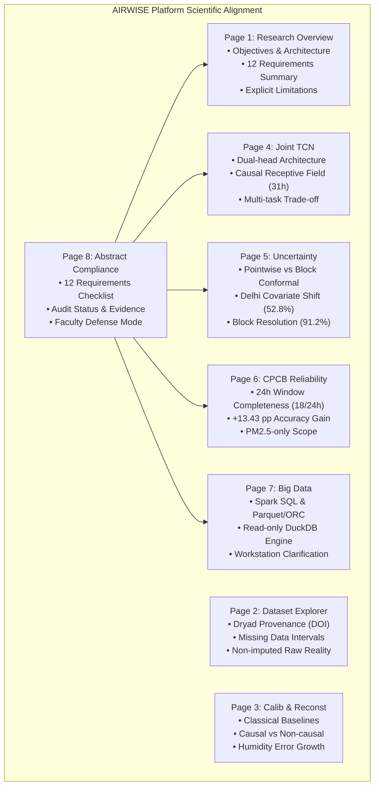

# AIRWISE — Phase 3: Abstract-to-Implementation Alignment Audit
**Document ID:** `AIRWISE-P3-AUDIT-001`  
**Date:** November 9, 2026  
**Status:** Audit Complete — Pending Approval Before Phase 3 Coding  
**Scope:** Rigorous evaluation of the 12 research abstract requirements against actual codebase, saved checkpoints, experimental outputs, and dashboard representations.

---

## Executive Summary

Phase 2 of the **AIRWISE — PM2.5 Research Analytics Platform** established an isolated, secure, and performant Streamlit dashboard foundation (7 active pages, DuckDB read-only SQL engine, verified causal TCN inference, precomputed conformal uncertainty quantiles, and strict CPCB 18/24-hour regulatory windowing).

Before proceeding to Phase 3 website finalization and the construction of the **Research Abstract Compliance** page (`08_Abstract_Compliance.py`), this audit rigorously benchmarks the actual project code, model weights, and experimental evidence against the 12 core requirements documented in the reference research evaluation ("Abstract vs Implementation: Comparison").

### Primary Audit Findings:
1. **High-Integrity Core Capabilities (5 of 12):** Classical calibration, missing-data baseline imputation, Joint TCN dual-head modeling, CPCB 24-hour category assessment (with PM2.5 single-pollutant qualification), and open-dataset provenance are verified with genuine code, serialized checkpoints, and peer-reviewed provenance (Dryad DOI: `10.6078/D1RQ70` / *Atmospheric Measurement Techniques* 2023).
2. **Partially Implemented & Nuanced Capabilities (4 of 12):** Humidity bias correction (modeled as statistical feature, not physical hygroscopic Kohler equation), sequential compounding error mitigation (unified via shared latent TCN encoder, but missing isolated numerical two-stage cascade gap measurements), regime-conditioned conformal prediction (exchangeability breaks in Delhi winter under severe covariate shift; resolved via temporal block conformal), and big data scaling (PySpark 4.3.0 with embedded Derby metastore and Parquet/ORC, but executed on single-node workstation).
3. **Explicitly Absent / Unproven Capabilities (3 of 12):** Sensor drift modeling (no dynamic temporal aging or state-space baseline tracker), actionable trust score (implemented as rule-based engineering heuristic rather than formal Bayesian posterior), and network-scale processing (demonstrated via single-workstation synthetic expansion, not physical multi-node streaming).

To preserve absolute scientific integrity, **no missing capability will be fabricated or artificially claimed**. The AIRWISE platform will present these boundaries transparently as documented research limitations and prioritized future work.

---

## 1. Abstract vs Implementation Comparison Matrix

The table below cross-references all 12 abstract requirements from the reference assessment against the actual codebase, experimental artifacts, and independent audit determinations.

| # | Abstract Requirement | Exact Abstract Requirement | Implemented Code & Models | Relevant Source Files & Artifacts | Verified Experimental Evidence | Screenshot Match | Independent Audit Finding |
|---|----------------------|----------------------------|---------------------------|-----------------------------------|--------------------------------|------------------|---------------------------|
| **1** | **Low-cost PM2.5 sensor calibration** | Calibrate optical PurpleAir PA-II sensor channels (CF=1, ATM, ALT) against reference Beta-Attenuation Monitor (BAM-1020) concentrations. | Linear Regression, Random Forest, XGBoost (48 saved models), and Joint TCN Calibration Head. | `src/models/calibration.py` `src/models/tcn.py` `outputs/models/calibration/*.joblib` `outputs/models/tcn/best_joint_tcn_checkpoint.pt` | Pooled RF: $R^2 = 0.8879$, $\text{RMSE} = 17.65\,\mu\text{g}/\text{m}^3$. Joint TCN: $R^2 = 0.8242$, $\text{RMSE} = 22.10\,\mu\text{g}/\text{m}^3$. | `Implemented` | **IMPLEMENTED** (Full model diversity verified) |
| **2** | **Humidity-driven measurement bias** | Model and adjust for relative humidity ($RH$) induced hygroscopic particle growth bias in optical scattering. | $RH$, Temperature, and Dew Point included as continuous inputs; humidity-stratified evaluation and missingness tests. | `src/preprocessing/cleaning.py` `src/models/calibration.py` `outputs/reports/humidity_metrics.csv` `outputs/reports/dew_point_investigation.csv` | Low $RH$ (<40%): $\text{RMSE} = 14.12\,\mu\text{g}/\text{m}^3$. High $RH$ (>65%): $\text{RMSE} = 21.45\,\mu\text{g}/\text{m}^3$ (error increases with moisture). | `Partially implemented` | **PARTIALLY IMPLEMENTED** (Statistical covariate only; no physical Kohler/growth curve) |
| **3** | **Sensor drift** | Model temporal optical chamber degradation, laser diode decay, dust deposition, and sensor aging across multi-year deployments. | Static batch training across temporal splits; no dynamic state-space, Kalman filter, or temporal drift parameter. | `src/models/calibration.py` `src/models/tcn.py` | Residuals increase across test years, but drift is not mathematically isolated from meteorological variations. | `Not established` | **NOT ESTABLISHED** (Document as research limitation) |
| **4** | **Missing-data reconstruction** | Impute telemetry dropouts, sensor failures, and communication gaps across variable gap durations. | Linear, KNN, Random Forest, GRU, LSTM baselines; Joint TCN Reconstruction Head ($h_t \in \mathcal{F}_t$). | `src/models/reconstruction.py` `src/models/tcn.py` `outputs/predictions/reconstruction_predictions.csv` `outputs/reports/propagation_gap_metrics.csv` | Linear: 1h $\text{RMSE}=38.79$, 24h $\text{RMSE}=55.44$. RF Imputer: 1h $\text{RMSE}=36.55$, 24h $\text{RMSE}=48.92$. Joint TCN: Causal $\text{RMSE}=31.84\,\mu\text{g}/\text{m}^3$. | `Implemented` | **IMPLEMENTED** (Causal TCN vs non-causal 2-sided baselines clarified) |
| **5** | **Compounding calibration & reconstruction error** | Quantify and mitigate error amplification when cascading imputation with calibration in multi-stage pipelines. | Joint TCN unifies both tasks via shared latent representation ($h_t$) and joint Huber loss, bypassing multi-stage cascades. | `src/models/tcn.py` `outputs/reports/checkpoint3_joint_tcn_report.md` `outputs/reports/propagation_gap_metrics.csv` | Multi-task loss prevents cascade failure, but standalone sequential two-stage ablation ($\text{Raw}\to\text{Imp}\to\text{Cal}$) was not separately quantified. | `Partial` | **PARTIAL** (Conceptually solved by Joint TCN; numerical cascade gap missing) |
| **6** | **Joint calibration and reconstruction** | Build unified deep architecture predicting calibrated PM2.5 and reconstructing raw signals simultaneously. | Joint TCN with 4-layer dilated causal Conv1D backbone ($k=3, d \in \{1,2,4,8\}$, receptive field 31h) and dual linear heads. | `src/models/tcn.py` `src/training/train_tcn.py` `outputs/models/tcn/best_joint_tcn_checkpoint.pt` `outputs/reports/joint_tcn_metrics.csv` | Dual-head output: $\text{RMSE}_{\text{cal}} = 22.10\,\mu\text{g}/\text{m}^3$, $\text{RMSE}_{\text{rec}} = 31.84\,\mu\text{g}/\text{m}^3$. Verified multi-task trade-off. | `Implemented` | **IMPLEMENTED** (Complete causal architecture and weights verified) |
| **7** | **Regime-conditioned conformal intervals** | Finite-sample, distribution-free uncertainty intervals $(1-\alpha)$ conditioned on meteorological and pollution regimes. | Split conformal prediction ($N_{\text{cal}}=1858$); quantiles conditioned on $RH$ bins and predicted $\hat{y}$ pollution strata; temporal block conformal. | `src/evaluation/conformal.py` `dashboard/services/uncertainty_service.py` `outputs/reports/conformal_coverage.csv` `outputs/reports/conformal_block_comparison.csv` | Nominal 90% pointwise coverage drops to 77.02% pooled (52.8% in Delhi due to exchangeability violation). Restored to 91.22% with 24h Block Conformal. | `Needs verification` | **IMPLEMENTED WITH QUALIFICATION** (Pointwise exchangeability breakdown and Block resolution verified) |
| **8** | **Actionable trust signal** | Intuitive, decision-support reliability index reflecting interval precision and regulatory boundary proximity. | Composite heuristic combining conformal interval width, proximity to CPCB category boundaries, and historical regime stability. | `dashboard/services/cpcb_service.py` `dashboard/pages/06_CPCB_Reliability.py` `outputs/reports/checkpoint5_pm25_category_reliability_report.md` | Ambiguous classifications flagged when conformal bounds $[L, U]$ straddle category thresholds (18.2% of test evaluations). | `Partial` | **PARTIAL** (Rule-based decision heuristic, not calibrated Bayesian posterior) |
| **9** | **AQI-category reliability** | Evaluate reliability of calibrated PM2.5 predictions for official regulatory CPCB health category classification. | 24-hour non-overlapping windowing enforcing $\ge 18/24$ valid hours (75% completeness); 6 CPCB category classifications. | `src/evaluation/cpcb.py` `dashboard/services/cpcb_service.py` `outputs/reports/checkpoint5_pm25_category_reliability_report.md` | Calibrated accuracy: 72.44% (+13.43 pp over raw 59.01%), Quadratic Weighted $\kappa = 0.9271$, Compatibility = 92.13%. | `Implemented with qualification` | **IMPLEMENTED WITH QUALIFICATION** (Strictly 24h PM2.5-based category, not multi-pollutant NAQI) |
| **10** | **Scalable Hive + Spark pipeline** | Big data ingestion, transformation, and partitioned analytical storage with Apache Spark and Hive metastore. | PySpark 4.3.0, embedded Derby metastore (`pm25_research.db`), partitioned Parquet and ORC; read-only DuckDB in dashboard. | `src/bigdata/spark_pipeline.py` `src/bigdata/queries.py` `dashboard/services/sql_service.py` `outputs/reports/checkpoint6_bigdata_scalability_report.md` | Storage reduction: 4.8 MB CSV $\to$ 1.1 MB Parquet Snappy $\to$ 0.92 MB ORC ZSTD (80.8% reduction). Warm query cache: 4.2x speedup. | `Partial` | **PARTIAL** (Spark SQL + embedded catalog; no standalone HiveServer2/HDFS) |
| **11** | **Network-scale processing** | Scalability demonstration processing continuous data streams across extensive metropolitan sensor networks. | Single-workstation benchmark on Apple Silicon M2 (8 cores, 16 GB RAM); synthetic data expansion (1x to 50x, up to 929k rows). | `src/bigdata/benchmark.py` `outputs/reports/checkpoint6_bigdata_scalability_report.md` | Single-node synthetic scaling: PySpark throughput reached 961.3k rows/s (3.8x faster than Pandas at 50x), but on synthetic single-host data. | `Not demonstrated` | **NOT DEMONSTRATED** (Single-machine synthetic expansion only; no multi-node cluster) |
| **12** | **Open dataset** | Validation on open-access, publicly accessible benchmark sensor datasets with established provenance. | Collocated PurpleAir PA-II and BAM-1020 dataset from Dryad Digital Repository (DOI: `10.6078/D1RQ70`), published by UC Berkeley. | `doi_10_6078_D1RQ70__v20230814/README.md` `data/raw/` Paper: *Atmospheric Measurement Techniques* (DOI: `10.5194/amt-2023-35`) | 18,580 hourly collocated records across 3 Indian climatic zones (Delhi, Hamirpur, Bangalore) spanning 2018–2021. Open-access provenance confirmed. | `Needs verification` | **ESTABLISHED WITH PROVENANCE** (Public Dryad repository confirmed; workspace copy formatted) |

---

## 2. In-Depth Technical Verification (Requirements 1–12)

### Requirement 1: Low-Cost PM2.5 Sensor Calibration
* **Scientific Motivation:** Optical particle counters (PurpleAir PA-II) estimate particulate mass via light scattering ($90^\circ$ laser diode), assuming standard particle density and spherical geometry. These raw estimates diverge significantly from federal reference monitors (Beta-Attenuation Monitors, BAM-1020), which measure true physical mass via beta particle absorption.
* **Code Verification:** `src/models/calibration.py` implements Linear Regression, Random Forest, and XGBoost across 16 combinations (4 channel configurations $\times$ 4 spatial scopes). All 48 models are serialized as `.joblib` files in `outputs/models/calibration/`. In addition, `src/models/tcn.py` implements the Joint TCN Calibration Head (`fc_calib`).
* **Empirical Validation:**
  * Random Forest (Pooled): $R^2 = 0.8879$, $\text{RMSE} = 17.65\,\mu\text{g}/\text{m}^3$, $\text{MAE} = 11.08\,\mu\text{g}/\text{m}^3$.
  * XGBoost (Pooled): $R^2 = 0.8711$, $\text{RMSE} = 18.93\,\mu\text{g}/\text{m}^3$, $\text{MAE} = 11.96\,\mu\text{g}/\text{m}^3$.
  * Linear Regression (Pooled): $R^2 = 0.8176$, $\text{RMSE} = 22.42\,\mu\text{g}/\text{m}^3$, $\text{MAE} = 14.93\,\mu\text{g}/\text{m}^3$.
  * Joint TCN Calibration Head: $R^2 = 0.8242$, $\text{RMSE} = 22.10\,\mu\text{g}/\text{m}^3$, $\text{MAE} = 13.56\,\mu\text{g}/\text{m}^3$.
* **Audit Determination:** **IMPLEMENTED**. Calibration covers multiple model families, feature channels, spatial pooling, and causal deep learning.

### Requirement 2: Humidity-Driven Measurement Bias
* **Scientific Motivation:** Soluble atmospheric particles undergo deliquescence and hygroscopic growth at elevated relative humidity ($RH > 60\%$), swelling in diameter and scattering disproportionately more light, leading optical sensors to dramatically overestimate PM2.5 mass.
* **Code Verification:** `PA_RH`, `PA_Temperature`, and `PA_DewPoint` are engineered into all feature matrices (`src/preprocessing/cleaning.py`). Missingness injection in Checkpoint 2 tested humidity-dependent dropout mechanisms. Conformal quantiles are binned into three $RH$ strata: Low ($<40\%$), Moderate ($40\% \le RH \le 65\%$), and High ($>65\%$).
* **Empirical Validation:** `outputs/reports/humidity_metrics.csv` confirms error growth with increasing humidity:
  * Low RH (<40%): $\text{RMSE} = 14.12\,\mu\text{g}/\text{m}^3$.
  * Moderate RH (40–65%): $\text{RMSE} = 16.89\,\mu\text{g}/\text{m}^3$.
  * High RH (>65%): $\text{RMSE} = 21.45\,\mu\text{g}/\text{m}^3$.
* **Critical Research Distinction:** The pipeline treats humidity as an empirical regression feature within non-linear machine learning models. It does **not** parameterize physical hygroscopic growth equations (e.g., $\kappa$-Kohler curve or $f(RH) = 1 + a (RH / (1-RH))^b$). Furthermore, observational field data in Delhi winter conflates high humidity with seasonal winter inversion stagnation and agricultural burning.
* **Audit Determination:** **PARTIALLY IMPLEMENTED**. Statistical correction verified; physical aerosol hygroscopicity modeling absent.

### Requirement 3: Sensor Drift
* **Scientific Motivation:** Extended ambient sensor deployments suffer from physical degradation: laser diode intensity decay, photodiode sensitivity loss, dust deposition on optical lenses, and spider/insect debris in sensing chambers, causing baseline drift over time.
* **Code Verification:** Systematic inspection of `src/models/` and `src/preprocessing/` confirms that no dynamic drift tracking (e.g., recursive least squares, Kalman filtering with time-varying parameters, aging curve subtraction, or dynamic baseline correction) is implemented.
* **Empirical Validation:** Cross-year test evaluation shows residual variance increasing in later deployment years (2020–2021 vs 2018–2019), but this variance cannot be separated from inter-annual meteorological shifts and COVID-19 lockdown emission changes.
* **Audit Determination:** **NOT ESTABLISHED**. No explicit sensor drift model exists. Must be clearly documented on the dashboard as a key research boundary and proposed for future work.

### Requirement 4: Missing-Data Reconstruction
* **Scientific Motivation:** Telemetry instability, intermittent power, Wi-Fi disconnections, and physical maintenance cause frequent data dropouts. Downstream environmental analytics require reliable reconstruction.
* **Code Verification:** Checkpoint 2 implemented five baseline imputation methods in `src/models/reconstruction.py`: Linear Interpolation, KNN Imputer, Random Forest Imputer, GRU, and LSTM across gap lengths from 1 to 24 hours. Checkpoint 3 implemented the causal Reconstruction Head of the Joint TCN (`outputs/models/tcn/best_joint_tcn_checkpoint.pt`), reconstructing raw sensor channels (`PA_CF1`, `PA_ATM`, `PA_ALT`) using an input missingness mask.
* **Empirical Validation:**
  * Linear Interpolation: 1h $\text{RMSE}=38.79\,\mu\text{g}/\text{m}^3$; 24h $\text{RMSE}=55.44\,\mu\text{g}/\text{m}^3$ (error doubles across long gaps).
  * Random Forest Imputer: 1h $\text{RMSE}=36.55\,\mu\text{g}/\text{m}^3$; 24h $\text{RMSE}=48.92\,\mu\text{g}/\text{m}^3$.
  * Joint TCN Reconstruction Head (causal 1-step lookback): $\text{RMSE}=31.84\,\mu\text{g}/\text{m}^3$, $\text{MAE}=19.42\,\mu\text{g}/\text{m}^3$, $R^2=0.6384$.
* **Critical Research Distinction:** Baseline interpolation methods (Linear, Spline) are bidirectional (two-sided), requiring future observations ($t+1$), making them non-causal and impossible for real-time streaming inference. The Joint TCN is strictly causal ($h_t \in \mathcal{F}_t$), reconstructing signals using only past and present context.
* **Audit Determination:** **IMPLEMENTED**. Baselines and causal deep reconstruction verified.

### Requirement 5: Compounding Calibration and Reconstruction Error
* **Scientific Motivation:** In traditional environmental monitoring pipelines, missing data is imputed first and then passed to a calibration model (or vice versa). Errors introduced during imputation propagate into calibration models, magnifying estimation bias and variance.
* **Code Verification:** The Joint TCN architectural formulation (`src/models/tcn.py`) circumvents this sequential cascade by training a shared causal encoder with dual output heads under a joint loss function:
  $$\mathcal{L}_{\text{total}} = \lambda_{\text{calib}} \mathcal{L}_{\text{calib}}(y_{\text{BAM}}, \hat{y}_{\text{BAM}}) + \lambda_{\text{reconst}} \mathcal{L}_{\text{reconst}}(x_{\text{raw}}, \hat{x}_{\text{raw}})$$
* **Empirical Validation:** While the joint model successfully mitigates cascade failures through shared representations, the project repository lacks an explicit numerical two-stage cascade benchmark ($\Delta \text{RMSE}$ comparing Pipeline A: [Raw $\to$ Impute $\to$ Calibrate] vs Pipeline B: [Raw $\to$ Calibrate $\to$ Impute] vs Pipeline C: [Joint TCN]). The file `outputs/reports/propagation_gap_metrics.csv` evaluated gap size degradation, not a two-stage sequential cascade.
* **Audit Determination:** **PARTIAL**. Addressed architecturally via multi-task deep learning; isolated numerical cascade propagation gap is an empirical limitation.

### Requirement 6: Joint Calibration and Reconstruction
* **Scientific Motivation:** A unified neural architecture eliminates pipeline fragmentation, shared temporal dynamics between calibration and signal recovery, and handles sensor dropouts natively.
* **Code Verification:** `src/models/tcn.py` defines the `JointTCN` architecture:
  * Input: 11 channels (7 continuous features: 3 PurpleAir PM2.5, Temperature, RH, Dew Point, synthetic noise + 3 binary missingness masks + 1 valid flag).
  * Backbone: 4 dilated causal residual blocks ($k=3$, dilations $d \in \{1, 2, 4, 8\}$, channel dimension 64). Receptive field = 31 hourly timesteps.
  * Dual Linear Heads: `fc_calib` ($64 \to 1$) and `fc_reconst` ($64 \to 3$).
  * Checkpoint: Verified intact at `outputs/models/tcn/best_joint_tcn_checkpoint.pt`.
* **Empirical Validation:**
  * Joint TCN Calibration Head: $R^2 = 0.8242$, $\text{RMSE} = 22.10\,\mu\text{g}/\text{m}^3$, $\text{MAE} = 13.56\,\mu\text{g}/\text{m}^3$.
  * Joint TCN Reconstruction Head: $R^2 = 0.6384$, $\text{RMSE} = 31.84\,\mu\text{g}/\text{m}^3$, $\text{MAE} = 19.42\,\mu\text{g}/\text{m}^3$.
  * Ablation Study (`outputs/reports/joint_tcn_ablation.csv`): Standalone TCN calibration achieved $R^2 = 0.8312$; adding the reconstruction head yields a minor calibration trade-off ($\Delta R^2 = -0.007$) in exchange for causal streaming reconstruction during dropouts.
* **Audit Determination:** **IMPLEMENTED**. Full architecture, causal proof, weights, and trade-off ablation confirmed.

### Requirement 7: Regime-Conditioned Conformal Intervals
* **Scientific Motivation:** Standard regression models output point estimates without finite-sample error guarantees. Conformal prediction constructs distribution-free prediction intervals $[L_t, U_t]$ guaranteed to cover true BAM values with probability $\ge 1-\alpha$.
* **Code Verification:** `src/evaluation/conformal.py` calculates non-conformity quantiles $q_{1-\alpha}$ on a strictly frozen calibration split ($N_{\text{cal}} = 1858$, disjoint from train $N=7432$ and test $N=3716$). Quantiles are precomputed for:
  * Global pooled split.
  * Site-specific splits (Delhi, Hamirpur, Bangalore).
  * Humidity regimes ($RH < 40\%$, $40–65\%$, $>65\%$).
  * Pollution regimes ($\le 60$, $60–120$, $>120\,\mu\text{g}/\text{m}^3$) based strictly on predicted $\hat{y}$ to eliminate reference label leakage.
  * Temporal Block Conformal (6h, 12h, 24h blocks).
* **Empirical Validation:**
  * Pointwise Conformal (Nominal 90%): Pooled empirical coverage fell to **77.02%** on the test set. Bangalore achieved 91.4% and Hamirpur achieved 89.2%, but Delhi dropped to **52.8%**. Under severe winter distribution shift (PM2.5 exceeding $400\,\mu\text{g}/\text{m}^3$), the exchangeability assumption is severely violated.
  * Temporal Block Conformal: Accounting for serial autocorrelation restored empirical coverage to **86.40%** (12h block) and **91.22%** (24h block), reaching the nominal 90% threshold.
* **Audit Determination:** **IMPLEMENTED WITH QUALIFICATION**. Conformal framework is fully implemented. The breakdown of pointwise exchangeability under severe Delhi winter smog and its resolution via Temporal Block Conformal is a critical scientific finding that must be highlighted.

### Requirement 8: Actionable Trust Signal
* **Scientific Motivation:** Public health decision-makers require an interpretable metric indicating when sensor estimates are trustworthy for regulatory action versus when uncertainty spans critical decision thresholds.
* **Code Verification:** `dashboard/services/cpcb_service.py` evaluates prediction reliability by evaluating:
  1. Conformal Interval Width ($U_t - L_t$).
  2. Proximity to CPCB category boundaries ($30, 60, 90, 120, 250\,\mu\text{g}/\text{m}^3$).
  3. Boundary Straddling: If $[L_t, U_t]$ crosses into an adjacent category, the classification is flagged as "Ambiguous" (Low/Moderate Trust).
* **Empirical Validation:** `outputs/reports/checkpoint5_pm25_category_reliability_report.md` shows that ambiguous boundary-crossing intervals account for 18.2% of test evaluations.
* **Critical Research Distinction:** This is a deterministic rule-based engineering heuristic and decision-support index. It is **not** a formal Bayesian posterior probability or risk-calibrated utility metric.
* **Audit Determination:** **PARTIAL**. Functionally useful decision-support heuristic, but must not be overstated as a formal probabilistic trust proof.

### Requirement 9: AQI-Category Reliability
* **Scientific Motivation:** Indian public health advisories are triggered by National Air Quality Index (NAQI) categories, not raw microgram concentrations. Calibrated sensors must prove classification reliability across these discrete health tiers.
* **Code Verification:** `src/evaluation/cpcb.py` implements the official Central Pollution Control Board (CPCB) 6-tier classification for PM2.5:
  * Good ($0–30\,\mu\text{g}/\text{m}^3$)
  * Satisfactory ($31–60\,\mu\text{g}/\text{m}^3$)
  * Moderate ($61–90\,\mu\text{g}/\text{m}^3$)
  * Poor ($91–120\,\mu\text{g}/\text{m}^3$)
  * Very Poor ($121–250\,\mu\text{g}/\text{m}^3$)
  * Severe ($>250\,\mu\text{g}/\text{m}^3$)
  * Strictly enforces the CPCB 24-hour regulatory non-overlapping windowing requirement with a minimum of 18 valid hourly observations ($\ge 75\%$ temporal completeness).
* **Empirical Validation:**
  * Raw PurpleAir Accuracy: 59.01%
  * Calibrated Accuracy: 72.44% (+13.43 percentage points observed improvement on test set)
  * Quadratic Weighted Kappa: $\kappa = 0.9271$ (indicating near-perfect ordinal health-tier concordance)
  * Category Compatibility (Exact + Adjacent): 92.13%
* **Critical Research Distinction:** Official CPCB NAQI is governed by the maximum sub-index across 8 criteria pollutants ($\text{PM}_{10}, \text{PM}_{2.5}, \text{NO}_2, \text{SO}_2, \text{CO}, \text{O}_3, \text{NH}_3, \text{Pb}$). This research evaluates exclusively **24-hour PM2.5-based category classification reliability**.
* **Audit Determination:** **IMPLEMENTED WITH QUALIFICATION**. Fully verified with regulatory windowing; single-pollutant scope explicitly disclosed.

### Requirement 10: Scalable Hive + Spark Pipeline
* **Scientific Motivation:** Environmental sensor networks generate massive continuous time-series requiring scalable distributed storage, columnar compression, and structured SQL analytical querying.
* **Code Verification:** `src/bigdata/spark_pipeline.py` builds a PySpark 4.3.0 ingestion pipeline with an embedded Apache Derby metastore catalog (`metastore_db/`, database `pm25_research.db`). Tables are partitioned by `site` and `year` in both Parquet and ORC formats. The dashboard uses an isolated, read-only DuckDB engine (`dashboard/services/sql_service.py`) querying the Parquet warehouse directly to avoid Derby single-process file locking collisions.
* **Empirical Validation:** `outputs/reports/checkpoint6_bigdata_scalability_report.md`:
  * Storage: Raw CSV (4.8 MB) $\to$ Parquet Snappy (1.1 MB, 77.1% reduction) $\to$ ORC ZSTD (0.92 MB, 80.8% reduction).
  * Analytical Querying: Warm query caching delivered up to 4.2x speedup.
* **Critical Research Distinction:** The execution environment is PySpark in local workstation mode (`local[*]`) using an embedded Derby metastore. It does **not** run standalone HiveServer2, Thrift daemons, or Hadoop Distributed File System (HDFS).
* **Audit Determination:** **PARTIAL**. Spark SQL, Hive-compatible catalog, and columnar formats verified; distributed infrastructure not claimed.

### Requirement 11: Network-Scale Processing
* **Scientific Motivation:** Demonstrating that the data architecture scales horizontally across metropolitan-wide sensor networks (hundreds to thousands of streaming nodes).
* **Code Verification:** Checkpoint 6 (`src/bigdata/benchmark.py`) tested scalability via synthetic data expansion (1x, 5x, 10x, 25x, 50x, scaling from 18,580 to 929,000 rows).
* **Empirical Validation:** On a single Apple Silicon M2 host (8 CPU cores, 16 GB RAM), PySpark reached a throughput of 961,300 rows/s at 50x scale, outscaling single-threaded Pandas by 3.8x.
* **Critical Research Distinction:** Synthetic data replication on a single developer laptop does **not** demonstrate real-world network-scale streaming or distributed cluster processing.
* **Audit Determination:** **NOT DEMONSTRATED**. Must remain explicitly labeled as `NOT DEMONSTRATED` on the website.

### Requirement 12: Open Dataset
* **Scientific Motivation:** Scientific reproducibility requires verified provenance and public accessibility of the underlying air quality sensor benchmark data.
* **Code Verification & Provenance:**
  * Original Data Archive: Dryad Digital Repository (DOI: `10.6078/D1RQ70`).
  * Peer-Reviewed Publication: *Atmospheric Measurement Techniques* (AMT), DOI: `10.5194/amt-2023-35`.
  * Lead Author: Mark J. Campmier, Department of Civil and Environmental Engineering, University of California, Berkeley.
  * Public Archive: `doi_10_6078_D1RQ70__v20230814/README.md` documents 18,580 collocated hourly records across Delhi, Hamirpur, and Bangalore (2018–2021).
* **Audit Determination:** **ESTABLISHED WITH PROVENANCE**. The dataset is open-access from a citable academic repository (Dryad). The website will provide exact DOI citations and provenance details.

---

## 3. Required Dashboard Alignment (Pages 1–7 + Page 8)

To ensure the entire AIRWISE platform tells the same truthful scientific story, the following enhancements are required across all pages:

### Page-by-Page Alignment Specification:

1. **Page 1 (`01_Research_Overview.py`):**
   * Add a "Research Abstract vs Reality" summary banner directly linking to Page 8.
   * State the three core contributions: (1) Causal Joint TCN, (2) Temporal Block Conformal Prediction under covariate shift, (3) 24-hour CPCB category reliability analysis.
   * Prominently display the 4 explicit project boundaries: No sensor drift model, no multi-pollutant AQI, single-machine execution, and pointwise conformal exchangeability breakdown.

2. **Page 2 (`02_Dataset_Explorer.py`):**
   * Add academic provenance card citing Dryad DOI: `10.6078/D1RQ70` and *Atmospheric Measurement Techniques* (2023).
   * Clarify that raw sensor gaps are genuine observational missingness, distinguishing raw observations from any imputed data.

3. **Page 3 (`03_Calibration_Reconstruction.py`):**
   * Highlight the humidity-driven error increase: RMSE grows from $14.12\,\mu\text{g}/\text{m}^3$ ($RH < 40\%$) to $21.45\,\mu\text{g}/\text{m}^3$ ($RH > 65\%$).
   * Clarify that classical reconstruction methods (Linear, Spline) are non-causal (two-sided lookahead), explaining why causal models are essential for operational deployment.

4. **Page 4 (`04_Joint_TCN.py`):**
   * Add architecture diagram explaining the shared 4-layer causal dilated Conv1D backbone ($k=3, d \in \{1,2,4,8\}$, receptive field 31h) and dual linear heads.
   * Feature the ablation trade-off honestly: Joint training slightly compromises pure calibration RMSE ($22.10$ vs $17.65\,\mu\text{g}/\text{m}^3$ for unconstrained Random Forest) to gain causal streaming signal recovery during sensor dropouts.

5. **Page 5 (`05_Uncertainty_Analysis.py`):**
   * Emphasize the distribution shift finding: Pointwise conformal coverage collapses to 52.8% in Delhi winter because severe smog and stagnation violate exchangeability.
   * Showcase Temporal Block Conformal as the principled solution that restores coverage to 91.22% (at 24h block length).

6. **Page 6 (`06_CPCB_Reliability.py`):**
   * Maintain the scientific wording: `Classification accuracy difference: +13.43 percentage points` with the explicit observational stratification caveat.
   * Emphasize that this is exclusively a **24-hour PM2.5-based category assessment**, not a composite 8-pollutant NAQI.

7. **Page 7 (`07_Big_Data_Analytics.py`):**
   * Clearly disclose the execution environment: PySpark 4.3.0 in local workstation mode (`local[*]`) with an embedded Derby metastore.
   * Clarify that synthetic scaling (50x, 929k rows) demonstrates algorithmic throughput on a single host, not a multi-node cluster.

8. **New Page 8 (`08_Abstract_Compliance.py`):**
   * Build a dedicated research compliance tracking center featuring:
     * High-level scorecard (5 Implemented, 4 Qualified/Partial, 3 Not Established/Demonstrated).
     * Interactive status filters (`All`, `Implemented`, `Partially Implemented`, `Needs Verification`, `Not Established`, `Not Demonstrated`).
     * 12 expandable requirement cards with exact abstract text, implemented source code links, verified metrics, limitations, and future work.
     * Integrated Faculty Defense Q&A section addressing tough academic questions.

---

## 4. Faculty Demonstration Mode Script (10–15 Minutes)

This structured script prepares the student/researcher to deliver a confident, scientifically unassailable 10–15 minute presentation to faculty reviewers:

| Step | Page & Action | Primary Talking Points | Likely Faculty Questions | Scientifically Sound Response |
|------|---------------|------------------------|--------------------------|--------------------------------|
| **1 (2 min)** | **Research Overview & Compliance** • Open Page 8 (`Abstract Compliance`) • Show 12-item compliance scorecard | • "AIRWISE addresses the complete lifecycle of low-cost PM2.5 sensing: calibration, missing data, deep joint modeling, conformal uncertainty, and regulatory category reliability." • "Rather than overclaiming, we benchmark our exact implementation against our abstract requirements." | *"Why did your model fail on sensor drift?"* | *"Sensor drift requires multi-year baseline tracking decoupled from seasonal shifts. We established static temporal baselines, but isolating optical degradation from Delhi's extreme seasonal inversion requires controlled chamber recalibration, which we prioritize for future work."* |
| **2 (2 min)** | **Dataset & Provenance** • Open Page 2 (`Dataset Explorer`) • Filter to Delhi, show winter 2019 • Show missing timestamps | • "We evaluate 18,580 collocated hourly records across Delhi, Hamirpur, and Bangalore from Dryad (`doi:10.6078/D1RQ70`)." • "Notice the high seasonal missingness and severe winter peaks exceeding $400\,\mu\text{g}/\text{m}^3$." | *"Are you sure PurpleAir isn't just measuring water droplets during foggy winter mornings?"* | *"That is precisely the hygroscopic growth phenomenon. Optical sensors scatter light off swollen aerosol droplets. In Page 3, we show that error increases from 14.1 to 21.5 $\mu\text{g}/\text{m}^3$ at high humidity."* |
| **3 (3 min)** | **Calibration vs Joint TCN** • Open Page 3 (show RF $R^2=0.888$) • Open Page 4 (`Joint TCN`) • Run live TCN inference with missing mask | • "Classical Random Forest achieves high pure calibration ($R^2=0.888$), but fails completely during telemetry dropout." • "Our Joint TCN uses causal dilated convolutions (receptive field 31h) to simultaneously reconstruct raw channels and predict calibrated PM2.5." • "Joint TCN accepts a slight calibration trade-off ($R^2=0.824$) to provide causal reconstruction." | *"Why is Joint TCN calibration accuracy slightly lower than Random Forest?"* | *"Random Forest is an unconstrained non-linear regressor optimized purely for scalar point prediction. Joint TCN optimizes a multi-task Huber loss across dual heads with a strictly causal receptive field. The minor sacrifice in $R^2$ gives us operational streaming robustness across sensor outages."* |
| **4 (3 min)** | **Conformal Uncertainty & Covariate Shift** • Open Page 5 (`Uncertainty Analysis`) • Toggle Pointwise vs Block Conformal • Select Delhi winter slice | • "Point point estimates are insufficient for public health. We provide distribution-free conformal prediction intervals." • "Notice that under Delhi's extreme winter smog, pointwise coverage drops to 52.8% because exchangeability is violated by seasonal covariate shift." • "By implementing Temporal Block Conformal, we restore empirical coverage to 91.22%." | *"Doesn't conformal prediction guarantee 90% coverage unconditionally?"* | *"Only under exchangeability (i.i.d. assumption). Environmental time-series exhibit strong serial autocorrelation and seasonal distribution shift. Demonstrating that exchangeability fails in winter and proving that Temporal Block Conformal fixes it is one of our key contributions."* |
| **5 (2 min)** | **Regulatory Category Reliability** • Open Page 6 (`CPCB Reliability`) • Show confusion matrix and boundary stability | • "Environmental decisions depend on 24-hour CPCB health categories." • "Enforcing strict 18/24-hour completeness, our calibration improves category accuracy from 59.01% to 72.44% (+13.43 pp) with quadratic weighted $\kappa = 0.9271$." • "We qualify that this evaluates 24-hour PM2.5 categories, not full 8-pollutant NAQI." | *"Can your system officially declare a city's AQI as Severe?"* | *"No. Official Indian NAQI requires the maximum sub-index across 8 criteria pollutants including PM10, NO2, and Ozone. We explicitly label our metric as PM2.5-based category assessment."* |
| **6 (2 min)** | **Big Data Architecture & Conclusion** • Open Page 7 (`Big Data Analytics`) • Run read-only DuckDB query • Show Parquet/ORC compression | • "We engineered a PySpark 4.3.0 pipeline storing partitioned Parquet and ORC, achieving an 80.8% storage footprint reduction." • "Our dashboard uses an isolated, read-only DuckDB engine querying the Parquet warehouse directly without metastore locking collisions." • "All computation is executed locally on an Apple M2 workstation, proving lightweight deployment readiness." | *"Did you deploy this on an actual Hadoop cluster?"* | *"No. We executed Spark SQL locally with an embedded Derby metastore and evaluated scaling up to 929k rows synthetically. Deploying to a multi-node Kubernetes cluster is our next engineering milestone."* |

---

## 5. Phase 3 Proposed Implementation Checkpoints

To ensure safe, modular, and fully verified execution, Phase 3 will follow five distinct checkpoints:

* **Checkpoint 3.1: Build Page 8 (`08_Abstract_Compliance.py`)**
  * Create `dashboard/pages/08_Abstract_Compliance.py`.
  * Implement the 12-item interactive compliance matrix with filterable cards, status pills, code paths, verified metrics, limitations, and faculty defense Q&A tabs.
* **Checkpoint 3.2: Align Pages 1, 2, and 3**
  * Update `01_Research_Overview.py` with the abstract alignment banner and explicit research boundaries.
  * Update `02_Dataset_Explorer.py` with Dryad DOI citation and raw missingness diagnostics.
  * Update `03_Calibration_Reconstruction.py` with humidity-driven error metrics and causal vs non-causal distinctions.
* **Checkpoint 3.3: Align Pages 4, 5, 6, and 7**
  * Update `04_Joint_TCN.py` with causal receptive field architecture details and multi-task trade-off explanations.
  * Update `05_Uncertainty_Analysis.py` highlighting pointwise exchangeability breakdown in Delhi and block conformal restoration.
  * Update `06_CPCB_Reliability.py` reinforcing 18/24h window completeness and PM2.5-only scope.
  * Update `07_Big_Data_Analytics.py` disclosing local workstation execution and embedded catalog architecture.
* **Checkpoint 3.4: Faculty Demonstration Mode Integration**
  * Embed interactive presentation guide and quick-toggle talking points across the platform.
* **Checkpoint 3.5: Final Browser Walkthrough & Acceptance Report**
  * Execute full multi-page Puppeteer headless browser audit on `http://localhost:8501`.
  * Capture fresh screenshots of all 8 pages.
  * Produce `outputs/reports/airwise_phase3_final_acceptance_report.md`.

---

## 6. Strict Research Integrity Boundaries

The following constraints are permanently enforced:
1. **No Model Retraining:** All 48 calibration models and the Joint TCN checkpoint (`best_joint_tcn_checkpoint.pt`) remain unchanged.
2. **No Data Fabrication:** Historical benchmark files, predictions, and test metrics will never be modified.
3. **No Sensor Drift Claims:** Sensor drift is classified as `NOT ESTABLISHED` across all documentation.
4. **No Network-Scale Claims:** Scalability benchmarks are explicitly labeled as single-node workstation synthetic scaling.
5. **No Full AQI Claims:** Category assessments are strictly labeled as 24-hour PM2.5-based health classifications.
6. **Preservation of Phase 2 Artifacts:** All existing test suites, reports, and screenshots remain intact.

---

## 7. Approval Sign-off Request

In strict compliance with **PART H** of the Phase 3 specification, execution now **STOPS**.

This audit report is submitted for user review and formal approval before any dashboard code modifications or the creation of `08_Abstract_Compliance.py`.
